# Day 1: HTTPS, SSL/TLS & Security Headers

**Date**: Week 4, Day 1  
**Phase**: 2 - FastAPI Mastery  
**Topic**: Understanding HTTPS, SSL/TLS, and Basic Security Headers

---

## Table of Contents

1. [Understanding HTTPS and SSL/TLS](#1-understanding-https-and-ssltls)
2. [SSL/TLS Deep Dive](#2-ssltls-deep-dive)
3. [Certificate Management](#3-certificate-management)
4. [Enforcing HTTPS in FastAPI](#4-enforcing-https-in-fastapi)
5. [SSL Termination](#5-ssl-termination)
6. [Security Headers Introduction](#6-security-headers-introduction)
7. [Complete Practical Example](#7-complete-practical-example)
8. [Testing Your Security Setup](#8-testing-your-security-setup)
9. [Common Pitfalls](#9-common-pitfalls)
10. [Key Takeaways](#10-key-takeaways)
11. [Practice Exercises](#11-practice-exercises)

---

## 1. Understanding HTTPS and SSL/TLS

### What is HTTPS?

HTTPS (**HyperText Transfer Protocol Secure**) is the secure version of HTTP. It is the foundation of data security on the modern web, providing a secure tunnel for data to travel through.

Think of HTTP as sending a postcard: anyone handling it (ISPs, network administrators, or malicious actors on public Wi-Fi) can read the message. HTTPS is like sending a locked armored briefcase where only the intended recipient has the key to see the contents.

**The Foundation:**

The presence of HTTPS indicates that the connection is encrypted and the identity of the website has been verified by a trusted third party.

---

### Visualizing the Security Gap

In an unsecured connection, a "Man-in-the-Middle" (MITM) can intercept and read your data easily.

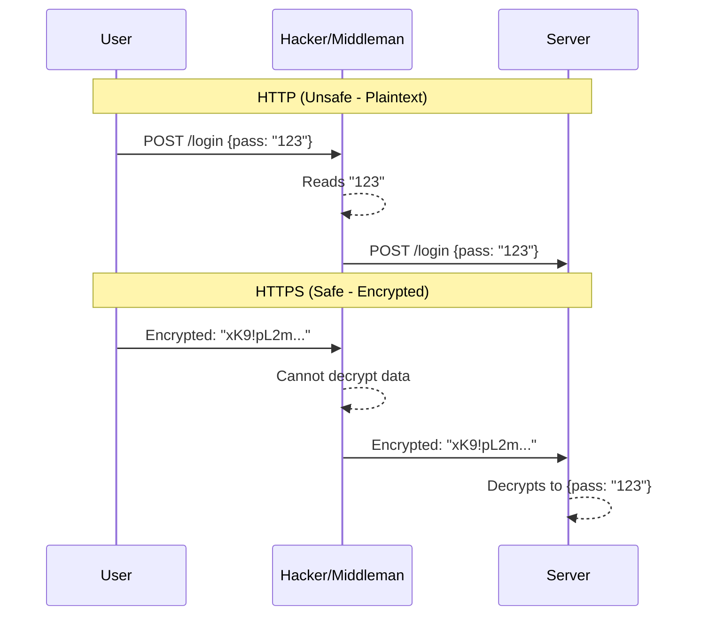

---

### HTTP vs HTTPS: Comparison

| Feature            | HTTP                        | HTTPS                                    |
| ------------------ | --------------------------- | ---------------------------------------- |
| **Protocol**       | HyperText Transfer Protocol | HTTP + Secure Sockets Layer              |
| **Default Port**   | `80`                        | `443`                                    |
| **Encryption**     | None (Plaintext)            | **Strong (TLS/SSL)**                     |
| **Authentication** | None                        | **Server Certificates**                  |
| **Data Integrity** | Vulnerable to tampering     | **Tamper-proof** (hashing)               |
| **SEO Ranking**    | Neutral                     | **Higher** (Preferred by search engines) |

#### The "Packet Sniffing" Reality

If you are building a FastAPI backend and a user sends a login request, here is what is visible on the network layer:

**1. On HTTP (Plaintext):**

```http
POST /login HTTP/1.1
Host: api.example.com
Content-Type: application/json

{
    "username": "alice",
    "password": "super_secret_password"
}

```

**2. On HTTPS (Encrypted):**

```text
(Encrypted Data Stream)
14 03 03 00 1A 2F E3 99 ... [Indecipherable binary data]

```

---

### SSL vs TLS (Protocol Evolution)

While the term "SSL Certificate" is still the common marketing name, modern security actually relies on the **TLS** protocol.

- **SSL (Secure Sockets Layer):** Developed by Netscape in the 1990s. All versions (1.0, 2.0, 3.0) are now **deprecated** and considered insecure due to known vulnerabilities like POODLE.
- **TLS (Transport Layer Security):** The modern, more secure successor.
- **TLS 1.2:** Still widely used and considered secure.
- **TLS 1.3:** The current best practice. It is faster (requiring fewer round-trips for the handshake) and removes outdated, weak encryption algorithms.

---

### Why HTTPS Matters (The CIA Triad)

In Backend Development, HTTPS addresses three core security pillars:

#### 1. Confidentiality

Prevents eavesdropping. Encryption ensures that even if data packets are intercepted, the contents remain private.

#### 2. Integrity

Ensures data is not modified during transit. If a middleman tries to alter the data (e.g., changing a transaction amount), the digital signature will fail, and the server/browser will terminate the connection.

#### 3. Authentication

Ensures you are communicating with the intended server. Digital Certificates prove that a domain belongs to the rightful owner and not an impersonator.

---

### FastAPI Context: Implementation

In production, HTTPS is typically handled at the **Infrastructure Layer** rather than inside the Python code itself:

1. **SSL Termination:** A Reverse Proxy (Nginx, Traefik) or a Cloud Load Balancer (AWS ALB) handles the HTTPS handshake and decryption.
2. **Internal Traffic:** The proxy forwards the request as standard HTTP to your FastAPI/Uvicorn application over a secure private network.

**For Local Development:**
To test HTTPS-specific features locally (like Secure Cookies), you can run Uvicorn with a certificate:

```bash
uvicorn main:app --ssl-keyfile=./key.pem --ssl-certfile=./cert.pem

```

## 2. SSL/TLS Deep Dive

To understand SSL/TLS, you first need to understand the two types of encryption it uses. The magic of HTTPS is that it combines both strategies to be both **secure** and **fast**.

### Part 1: The Cryptography Basics

#### 1. Symmetric Encryption (The "Fast" Way)

Think of this like a standard **House Key**.

- **How it works:** The _same key_ is used to lock (encrypt) and unlock (decrypt) the door.
- **Pros:** It is extremely fast and efficient for large amounts of data.
- **Cons:** **The Delivery Problem.** How do I send you the key without a hacker seeing it? If I mail it to you, the mailman might copy it.

#### 2. Asymmetric Encryption (The "Secure" Way)

Think of this like a **Public Mailbox**.

- **How it works:** There are two mathematically related keys.
- **Public Key:** Anyone can use this to _lock_ a message (drop mail in the slot). You give this to everyone.
- **Private Key:** Only YOU have this. It is the only key that can _unlock_ the message.

- **Pros:** I can send you a message safely without ever meeting you. I just use your Public Key.
- **Cons:** It is very slow and computationally heavy.

### Part 2: The "Hybrid" Solution

HTTPS uses a clever trick:

1. Use **Asymmetric Encryption** (Slow) just for the first few seconds to securely share a "Secret Password."
2. Once both sides have the password, switch to **Symmetric Encryption** (Fast) for the rest of the conversation.

---

### Part 3: The Handshake (Step-by-Step)

Here is exactly what happens when your backend receives a request.

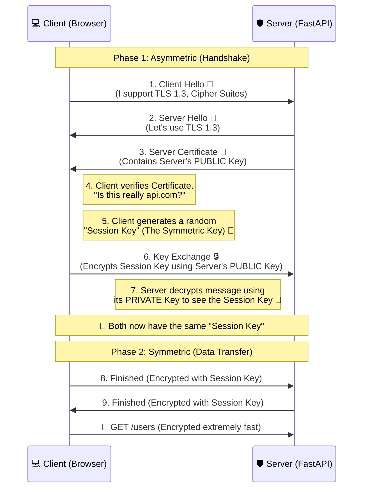

#### Detailed Explanation of the Steps

**Step 1: Negotiation (Client/Server Hello)**

- **Action:** The browser and server introduce themselves.
- **Context:** They agree on the language they will speak (e.g., "Let's use TLS 1.3").

**Step 2: Identity (The Certificate)**

- **Action:** The server sends its **SSL Certificate**.
- **The Key Moment:** Inside this certificate is the server's **Public Key**.
- **Why?** This allows the client to send a message that _only_ the server can read.

**Step 3: The Key Exchange (Asymmetric Encryption)**

- **The Problem:** The client needs to send a "Session Key" (a temporary password) to the server, but the hacker is watching.
- **The Solution:** The client takes the **Session Key** and encrypts it using the server's **Public Key**.
- **The Magic:** Because it is encrypted with the Public Key, **only the Private Key** (which lives secretly on your server) can decrypt it. The hacker sees only garbage.

**Step 4: The Switch (Symmetric Encryption)**

- **Action:** The server receives the encrypted package, uses its Private Key to open it, and finds the **Session Key**.
- **Result:** Now, _both_ the client and the server have the exact same Session Key. They discard the slow asymmetric keys and use the fast Session Key for the actual API data (JSON, images, etc.).

---

### Backend Engineering Note: Forward Secrecy

In modern TLS (TLS 1.3), we use a technique called **Perfect Forward Secrecy (PFS)**.

- **The Old Way:** The client encrypted the Session Key directly with the server's Public Key (like the diagram above). If a hacker recorded that traffic and stole your Private Key 5 years later, they could decrypt _everything_ from the past.
- **The Modern Way (Diffie-Hellman):** The client and server don't actually send the key across the wire. Instead, they exchange mathematical parameters that allow them to _calculate_ the same key independently.
- **Benefit:** The Session Key never actually travels through the network. Even if your server is hacked later, past conversations remain secure.

### Summary Table

| Stage             | Encryption Type | Purpose                              | Speed   |
| ----------------- | --------------- | ------------------------------------ | ------- |
| **Handshake**     | **Asymmetric**  | To securely share the "Session Key". | Slow 🐢 |
| **Data Transfer** | **Symmetric**   | To transfer actual data (JSON/HTML). | Fast 🐇 |

## 3. Certificate Management

### What is an SSL Certificate?

An SSL Certificate is a **digital ID card** for your server. Just as a passport proves you are a citizen of a country, an SSL certificate proves your server owns a specific domain (like `api.example.com`).

It serves two main purposes:

1. **Identity:** "I am truly https://www.google.com/search?q=google.com, not an imposter."
2. **Encryption:** "Here is my Public Key so you can send me secret messages."

#### The Anatomy of a Certificate

If you inspect a certificate (using `openssl x509 -in cert.pem -text`), it contains:

- **Subject:** Who owns this? (`CN=example.com`)
- **Issuer:** Who vouched for them? (`Let's Encrypt`)
- **Validity:** Expiration dates (`Not Before` / `Not After`)
- **Public Key:** The key used to encrypt the initial handshake.
- **Digital Signature:** The "wax seal" from the Issuer proving this document hasn't been forged.

**Certificate structure:**

```
Certificate:
    Data:
        Version: 3 (0x2)
        Serial Number: 04:00:00:00:00:01:15:4b:5a:c3:94
        Signature Algorithm: sha256WithRSAEncryption
        Issuer: C=US, O=Let's Encrypt, CN=R3
        Validity:
            Not Before: Jan 01 00:00:00 2024 GMT
            Not After:  Apr 01 23:59:59 2024 GMT
        Subject: CN=example.com
        Subject Public Key Info:
            Public Key Algorithm: rsaEncryption
                RSA Public-Key: (2048 bit)
        X509v3 Extensions:
            X509v3 Subject Alternative Name:
                DNS:example.com, DNS:www.example.com
    Signature Value:
        5a:c3:94... (omitted for brevity)
```

---

### The Chain of Trust (How Trust Works)

A browser does not inherently know that your server is trustworthy. Trust is established through a **hierarchical delegation** system. If the browser trusts the "Parent," and the "Parent" vouches for the "Child," the browser trusts the "Child."

#### The Trust Hierarchy

This hierarchy is designed to protect the most critical keys while allowing for daily certificate issuance.

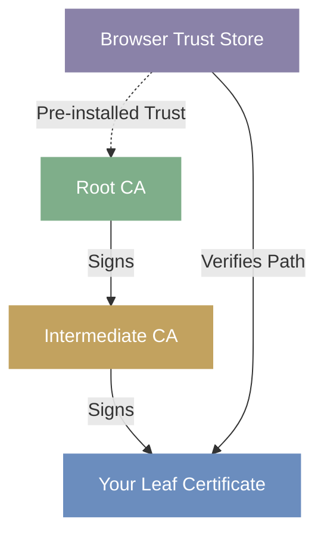

1. **Root CA (The Source of Trust):**
   These are the "Master Keys" of the internet. Public Certificate Authorities (CAs) keep these keys on hardware that is never connected to the internet. A list of these Root CAs is pre-shipped with every Operating System (Windows, macOS, Linux) and Browser.
2. **Intermediate CA (The Representative):**
   Root CAs do not sign certificates for individual websites directly. Instead, they sign an "Intermediate" certificate. This acts as a buffer. If an intermediate key is compromised, it can be revoked without needing to replace the Root CA in every computer on earth.
3. **Leaf Certificate (Your Server):**
   This is the certificate issued specifically for your domain (e.g., `api.example.com`). It is called a "Leaf" because it is at the end of the tree branch.

---

### The Verification Process

When a browser connects to your backend, it performs a **Chain Validation**:

1. **The Leaf Check:** The browser looks at your certificate. It sees it was signed by "Intermediate X."
2. **The Intermediate Check:** It then asks, "Who signed Intermediate X?" It sees it was signed by "Root CA Y."
3. **The Root Check:** It checks its internal **Trust Store**. If "Root CA Y" is in its local list, the connection is marked secure.

---

### Why Browsers Show "Insecure" Warnings

As a backend engineer, you will encounter connection errors if this chain is broken. Common causes include:

- **Missing Intermediate Certificates:** If your server only sends the Leaf certificate but not the Intermediate, the browser cannot "bridge the gap" to the Root CA. This is why tools like Certbot provide a `fullchain.pem` (Leaf + Intermediate) instead of just a `cert.pem`.
- **Self-Signed Certificates:** Since you are the "Root" of your own self-signed cert, and you are not in the browser's Trust Store, the chain is untrusted.
- **Expired Certificates:** If any certificate in the chain (Leaf, Intermediate, or Root) expires, the entire path is considered invalid.

> **Engineering Note:** When configuring Nginx or a Load Balancer, always point the configuration to the **Full Chain** file. Serving only the Leaf certificate is a common configuration error that leads to mobile app failures or SSL handshake errors in older clients.

### The Verification Process

When a browser connects to your backend, it performs a **Chain Validation**:

1. **The Leaf Check:** The browser looks at your certificate. It sees it was signed by "Intermediate X."
2. **The Intermediate Check:** It then asks, "Who signed Intermediate X?" It sees it was signed by "Root CA Y."
3. **The Root Check:** It checks its internal **Trust Store**. If "Root CA Y" is in its local list, the connection is marked secure.

---

### Why Browsers Show "Insecure" Warnings

As a backend engineer, you will encounter connection errors if this chain is broken. Common causes include:

- **Missing Intermediate Certificates:** If your server only sends the Leaf certificate but not the Intermediate, the browser cannot "bridge the gap" to the Root CA. This is why tools like Certbot provide a `fullchain.pem` (Leaf + Intermediate) instead of just a `cert.pem`.
- **Self-Signed Certificates:** Since you are the "Root" of your own self-signed cert, and you are not in the browser's Trust Store, the chain is untrusted.
- **Expired Certificates:** If any certificate in the chain (Leaf, Intermediate, or Root) expires, the entire path is considered invalid.

> **Engineering Note:** When configuring Nginx or a Load Balancer, always point the configuration to the **Full Chain** file. Serving only the Leaf certificate is a common configuration error that leads to mobile app failures or SSL handshake errors in older clients.

---

### Certificate Types

#### 1. Self-Signed Certificates

You create this yourself on your laptop.

- **Cost:** Free.
- **Trust:** **None.** Browsers will show a scary red warning ("Your connection is not private").
- **Use Case:** Localhost development (`https://localhost:8000`).

```bash
# Quick command to generate a self-signed cert for localhost
openssl req -x509 -newkey rsa:4096 -nodes \
  -keyout key.pem -out cert.pem -days 365 \
  -subj "/CN=localhost"

```

#### 2. Domain Validated (DV)

- **Validation:** Automated check. "Do you control this DNS record?"
- **Cost:** Free (via Let's Encrypt) to Cheap.
- **Speed:** Issued in minutes.
- **Use Case:** 99% of modern websites and APIs.

#### 3. Organization Validated (OV) & Extended Validation (EV)

- **Validation:** Humans verify your business paperwork.
- **Cost:** Expensive.
- **Use Case:** Banks, Governments. (Note: Modern browsers no longer show the "Green Bar" for EV certs, so their value has decreased).

---

### Practical: Let's Encrypt & Certbot

**Let's Encrypt** is the industry standard for free, automated SSL. We use a tool called **Certbot** to talk to Let's Encrypt.

#### 1. The Challenge (Authentication)

To get a certificate, Certbot must prove you own the domain. It usually does this by:

- **HTTP-01 Challenge:** Putting a tiny file in a specific folder on your web server. Let's Encrypt checks if it can download that file from your domain.
- **DNS-01 Challenge:** Asking you to add a TXT record to your DNS settings.

#### 2. Generating a Certificate

```bash
# Standalone mode (if you don't have Nginx running yet)
sudo certbot certonly --standalone -d api.example.com

# Output usually goes to:
# /etc/letsencrypt/live/api.example.com/fullchain.pem (Public Cert + Intermediate)
# /etc/letsencrypt/live/api.example.com/privkey.pem   (Private Key - KEEP SECRET)

```

#### 3. Auto-Renewal

Let's Encrypt certs expire in **90 days**. You must automate renewal.

```bash
# Test if renewal works
sudo certbot renew --dry-run

# Add a cron job (Linux Scheduler) to run this daily
0 3 * * * certbot renew --quiet

```

---

### Understanding File Extensions (The Confusing Part)

Backend engineers often get confused by the different file extensions. Here is a cheat sheet:

| Extension     | Content           | Description                                                                      |
| ------------- | ----------------- | -------------------------------------------------------------------------------- |
| `.pem`        | **Text** (Base64) | Can contain a Key, a Cert, or a Chain. Most common format on Linux.              |
| `.crt`        | **Certificate**   | Usually just the public certificate.                                             |
| `.key`        | **Private Key**   | **SECRET**. Never share this. Used to sign/decrypt.                              |
| `.pfx / .p12` | **Binary**        | A password-protected bundle containing both Cert + Key (common in Windows/Java). |

> **Tip:** In Nginx/FastAPI, we usually deal with `.pem` files.
>
> - `fullchain.pem` = Your Certificate + Intermediate CA.
> - `privkey.pem` = Your Secret Key.

---

### Nginx Configuration (SSL Termination)

In a real deployment, Nginx sits in front of your FastAPI app. It handles the encryption so your Python app doesn't have to.

```nginx
server {
    listen 443 ssl http2;
    server_name api.example.com;

    # 1. Path to the Certificate Chain
    ssl_certificate /etc/letsencrypt/live/api.example.com/fullchain.pem;

    # 2. Path to the Private Key
    ssl_certificate_key /etc/letsencrypt/live/api.example.com/privkey.pem;

    # 3. Security Settings (Standard Best Practices)
    ssl_protocols TLSv1.2 TLSv1.3;
    ssl_ciphers HIGH:!aNULL:!MD5;

    location / {
        # Forward plain HTTP to FastAPI running on port 8000
        proxy_pass http://127.0.0.1:8000;
        proxy_set_header Host $host;
        proxy_set_header X-Forwarded-Proto $scheme;
    }
}

```

### Certificate Lifecycle Management

Failing to renew a certificate causes an outage. Users will be blocked from your site.

**The Lifecycle Loop:**

1. **Issue:** Request cert from CA.
2. **Install:** Configure Load Balancer/Nginx.
3. **Monitor:** Check expiration date (`openssl x509 -enddate -noout -in cert.pem`).
4. **Renew:** Run Certbot (usually at day 60 of 90).
5. **Reload:** **Crucial Step!** Nginx must be reloaded (`nginx -s reload`) to pick up the new file, otherwise it keeps serving the old expired one.

## 4. Enforcing HTTPS in FastAPI

In a professional architecture, we rarely expose our Python application directly to the internet. Instead, we use a **Reverse Proxy**.

### Understanding the Architecture

- **Reverse Proxy (Nginx/Traefik/Caddy):** A dedicated web server that sits in front of your application. It handles high-volume traffic, SSL/TLS encryption (SSL Termination), and caching.
- **Nginx:** The most common reverse proxy. It acts as a "security guard" that receives requests from users and passes them to your FastAPI app.
- **SSL Termination:** This is the process where the Reverse Proxy handles the HTTPS handshake, decrypts the data, and passes the "plain" request to FastAPI over a secure internal network.

---

### The Middleware Approach: HTTPS Redirection

While Nginx usually handles redirects, adding enforcement in FastAPI ensures that your application logic stays secure even if the infrastructure configuration changes.

```python
from fastapi import FastAPI, Request
from fastapi.responses import RedirectResponse
from starlette.middleware.base import BaseHTTPMiddleware

app = FastAPI()

class HTTPSRedirectMiddleware(BaseHTTPMiddleware):
    async def dispatch(self, request: Request, call_next):
        # 1. Identify the original protocol
        # 'x-forwarded-proto' is set by the reverse proxy (Nginx)
        proto = request.headers.get("x-forwarded-proto", "http")

        # 2. Redirect if the connection is not secure
        if proto == "http":
            secure_url = request.url.replace(scheme="https")
            return RedirectResponse(
                url=secure_url,
                status_code=301 # Permanent Redirect
            )

        return await call_next(request)

app.add_middleware(HTTPSRedirectMiddleware)

```

**How it works:**

1. **User visits:** `http://example.com`
2. **Nginx receives request:** It forwards the request to FastAPI and adds the header `X-Forwarded-Proto: http`.
3. **Middleware detects HTTP:** FastAPI reads the header and sees it is not secure.
4. **Returns 301 redirect:** FastAPI sends a response telling the browser to go to `https://example.com`.
5. **Browser makes new request:** The browser automatically reconnects via HTTPS.
6. **Secure connection established:** Nginx handles the SSL, and FastAPI now sees `X-Forwarded-Proto: https`.

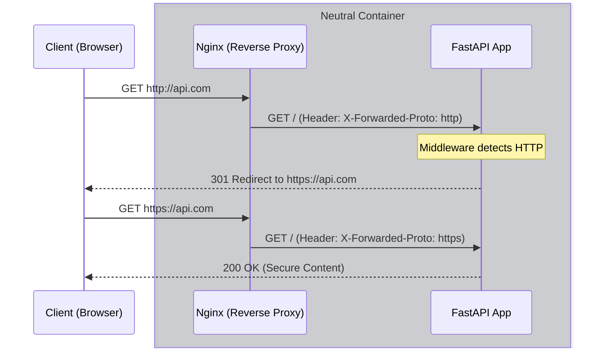

---

### HTTPS-Only Cookies

If you use cookies for authentication, setting them over an unencrypted connection allows attackers to perform **Session Hijacking**.

```python
from fastapi import FastAPI, Response

app = FastAPI()

@app.post("/login")
async def login(response: Response):
    response.set_cookie(
        key="session_token",
        value="secret_value",
        # --- Security Attributes ---
        secure=True,     # Browser only sends cookie over HTTPS
        httponly=True,   # Prevents XSS (JS cannot read the cookie)
        samesite="lax",  # Mitigates CSRF attacks
        # --- Expiration ---
        max_age=3600,
        path="/"
    )
    return {"status": "success"}

```

**Why `secure=True` is mandatory:**
Without this flag, if a user visits a `http://` version of your site, the browser will send the session cookie in **plaintext**. An attacker on the same network could steal this cookie and impersonate the user.

---

### Trusted Host Middleware

To prevent **Host Header Attacks** (where an attacker manipulates the header to trick your app into generating malicious links), FastAPI uses a whitelist.

```python
from fastapi import FastAPI
from starlette.middleware.trustedhost import TrustedHostMiddleware

app = FastAPI()

# Only allow requests for these specific domains
app.add_middleware(
    TrustedHostMiddleware,
    allowed_hosts=["api.example.com", "www.example.com"]
)

```

---

### Practical Nginx Configuration

To make the "How it works" steps above function correctly, your Nginx configuration must explicitly pass the protocol information to FastAPI.

**Example Nginx Snippet:**

```nginx
location / {
    proxy_pass http://localhost:8000;
    proxy_set_header Host $host;

    # This line tells FastAPI if the original request was HTTP or HTTPS
    proxy_set_header X-Forwarded-Proto $scheme;

    proxy_set_header X-Real-IP $remote_addr;
}

```

---

## 5. SSL Termination

### What is SSL Termination?

SSL Termination is the practice of ending an SSL/TLS connection at an intermediary device (like a Load Balancer or Reverse Proxy) instead of at the application server itself.

The intermediary device:

1. **Decrypts** the incoming HTTPS traffic from the user.
2. **Inspects** the request (for routing, caching, or security filtering).
3. **Forwards** the request as plain HTTP to the backend application over a secure internal network.

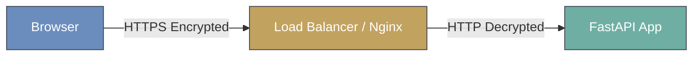

---

### SSL Termination Locations

#### 1. At the Load Balancer (Cloud Strategy)

In cloud environments (AWS, GCP, Azure), the Cloud Load Balancer handles the certificates.

- **Workflow:** `Internet → Cloud Load Balancer (SSL Ends) → EC2/Containers (HTTP)`.
- **Pros:** Managed certificates (e.g., AWS Certificate Manager), zero CPU load on your app for encryption, and easy scaling.
- **Cons:** Traffic between the Load Balancer and your app is unencrypted (fine for private VPCs, but a consideration for highly sensitive data).

#### 2. At the Reverse Proxy (Nginx/Traefik)

Common for VPS or single-server setups where Nginx sits on the same machine as FastAPI.

- **Workflow:** `Internet → Nginx (SSL Ends) → FastAPI (Unix Socket or Localhost HTTP)`.
- **Pros:** High performance, allows for advanced features like **Gzip compression** and **Request Rate Limiting** before the request even hits Python.
- **Cons:** Requires manual certificate management (Certbot/Cron jobs).

#### 3. At the Application Server (The "Direct" Way)

Running SSL directly inside Uvicorn.

- **Workflow:** `Internet → FastAPI/Uvicorn (HTTPS)`.
- **Pros:** End-to-end encryption to the very last inch.
- **Cons:** Significant CPU overhead for the Python process. Python is slower at crypto operations than C-based Nginx. Generally discouraged for high-traffic production.

---

### Strategy Comparison Table

| Scenario                    | Recommended Approach      | Key Reason                                      |
| --------------------------- | ------------------------- | ----------------------------------------------- |
| **Production (Cloud)**      | **Load Balancer**         | Automated scaling and certificate rotation.     |
| **Production (Single VPS)** | **Reverse Proxy (Nginx)** | Best balance of control and performance.        |
| **Development**             | **Application Server**    | Fastest to set up and test.                     |
| **Zero-Trust Network**      | **SSL Passthrough**       | Encryption remains active until the app server. |

---

### The "Trust" Problem: X-Forwarded-Proto

When SSL is terminated elsewhere, FastAPI's `request.url.scheme` will return `http`. This can break logic that generates absolute URLs or checks for secure connections.

To fix this, the proxy sends **Forwarded Headers**.

#### Header Definitions

- `X-Forwarded-Proto`: Tells the app the original protocol (`https`).
- `X-Forwarded-For`: The actual IP of the user (otherwise the app sees the Proxy's IP).
- `X-Forwarded-Host`: The original domain name requested by the user.

#### Implementation in FastAPI

You can create a helper to determine the "true" protocol:

```python
from fastapi import FastAPI, Request

app = FastAPI()

@app.get("/security-check")
async def check_security(request: Request):
    # Check if the connection is truly secure
    # (Checking both local scheme and proxy headers)
    is_https = (
        request.url.scheme == "https" or
        request.headers.get("x-forwarded-proto") == "https"
    )

    return {
        "is_secure": is_https,
        "original_protocol": request.headers.get("x-forwarded-proto"),
        "client_ip": request.headers.get("x-forwarded-for")
    }

```

---

### Backend Engineering Best Practice: SSL Termination

1. **Offload Early:** Whenever possible, let Nginx or a Load Balancer handle the "heavy lifting" of encryption. It is written in C and optimized for this task.
2. **Internal Security:** If your internal network is not 100% trusted, use **mTLS** (Mutual TLS) between the Proxy and the App, or simply terminate SSL at the proxy but use a separate encrypted tunnel for internal traffic.
3. **Proxy Configuration:** Ensure your Nginx configuration includes `proxy_set_header X-Forwarded-Proto $scheme;` or FastAPI will not know the user is using HTTPS.

## 6. Security Headers Introduction

Security headers are HTTP response headers that instruct the browser to activate specific security filters and restrictions. In a backend architecture, these headers provide **defense-in-depth**: if your code has a vulnerability, these headers can stop the browser from allowing an attacker to exploit it.

---

### Why Security Headers Matter

Without these instructions, browsers prioritize "convenience" over security, making your application vulnerable to several classic attack vectors:

1. **Clickjacking:** Masking your site inside an invisible iframe to trick users into clicking buttons.
2. **MIME Sniffing:** Tricking the browser into executing a text file as if it were JavaScript.
3. **Cross-Site Scripting (XSS):** Injecting malicious scripts into your pages.
4. **Data Injection:** Forcing the browser to load resources from untrusted external servers.

---

### Content-Security-Policy (CSP)

CSP is the most powerful security tool in your header toolkit. Think of it as a **"Security Guest List"** for your website.

When a browser visits your site, CSP tells it: _"Only accept resources (scripts, images, styles) from these specific trusted places. If a resource isn't on the list, block it immediately."_

---

#### 1. How CSP Works: The "Whitelist" Concept

By default, browsers are very "trusting"—they will execute almost any script they find in your HTML. An attacker can exploit this by injecting a malicious `<script>` tag.

With CSP, you switch the browser to a **"Deny by Default"** mode. Even if an attacker successfully injects a malicious script, the browser will look at your CSP list, see that the attacker's domain is not listed, and **refuse to run the script**.

#### 2. Key Directives (The "Categories")

CSP allows you to set different rules for different types of content:

| Directive             | What it controls                                      | Analogy                                                           |
| --------------------- | ----------------------------------------------------- | ----------------------------------------------------------------- |
| **`default-src`**     | The fallback rule for everything else.                | The "General Rule" for the house.                                 |
| **`script-src`**      | Where JavaScript files can come from.                 | Who is allowed to speak at the meeting.                           |
| **`img-src`**         | Where images can be loaded from.                      | Who is allowed to hang pictures on the wall.                      |
| **`connect-src`**     | Which servers your app can talk to (APIs/WebSockets). | Who you are allowed to call on the phone.                         |
| **`frame-ancestors`** | Who is allowed to embed your site in an `<iframe>`.   | Who is allowed to put a picture of your house in their scrapbook. |

---

#### 3. Common Source Values

- **`'self'`**: Only allow resources from your own domain (the same origin).
- **`'none'`**: Block everything for this category.
- **`https://cdn.example.com`**: Allow resources specifically from this external URL.
- **`'unsafe-inline'`**: Allows scripts written directly inside HTML tags. **Avoid this**, as it makes XSS attacks possible again.

---

#### 4. Implementation Strategy for Backend APIs

If you are building a **FastAPI REST API**, your implementation should be extremely strict. Since an API serves JSON—not HTML—it should **never** need to load external scripts, styles, or images.

**The "Strict" Policy:**
`default-src 'none'; frame-ancestors 'none';`

- `default-src 'none'`: Tells the browser: "Don't load _anything_ (scripts, images, etc.) if this URL is opened."
- `frame-ancestors 'none'`: Tells the browser: "Never allow this API response to be shown inside an `<iframe>`."

#### 5. Code Implementation in FastAPI

```python
from fastapi import FastAPI, Request

app = FastAPI()

@app.middleware("http")
async def apply_csp_header(request: Request, call_next):
    response = await call_next(request)

    # We define a policy that blocks everything by default.
    # This is safe for APIs because they only return data (JSON).
    csp_policy = "default-src 'none'; frame-ancestors 'none';"

    response.headers["Content-Security-Policy"] = csp_policy
    return response

```

#### Visualizing the Protection

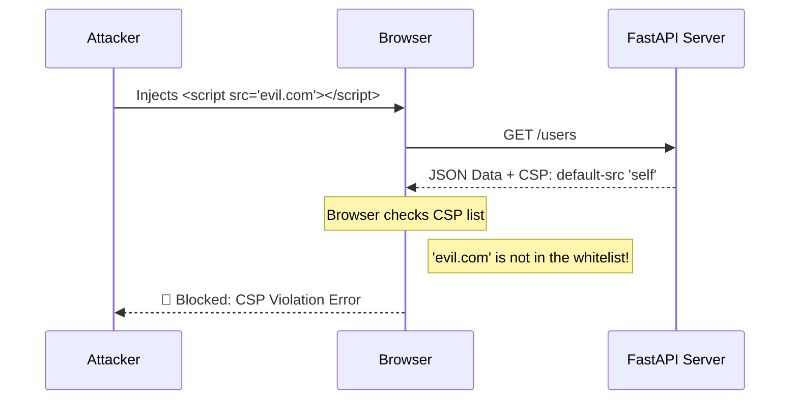

---

### X-Frame-Options (Clickjacking Protection)

This header specifically prevents your site from being embedded in `<frame>`, `<iframe>`, or `<object>` tags on other sites.

**The Attack:** An attacker puts your "Delete Account" page in a 100% transparent iframe on top of a "Win a Free iPhone" button on their site.

**The Fix:**

- `DENY`: No one can iframe your site. (Best for APIs).
- `SAMEORIGIN`: Only your own site can iframe itself.

```python
response.headers["X-Frame-Options"] = "DENY"

```

---

### X-Content-Type-Options (MIME Sniffing)

Browsers sometimes ignore the `Content-Type` header and try to "guess" the file type by looking at the first few bytes. This is called **MIME Sniffing**.

**The Attack:** An attacker uploads a `.jpg` file to your server that actually contains malicious JavaScript. If a user views this "image," the browser might "sniff" the script and execute it.

**The Fix:**

```python
# Force the browser to respect the Content-Type header
response.headers["X-Content-Type-Options"] = "nosniff"

```

---

### Practical: The "Security Header Bundle" for FastAPI

Instead of writing a different middleware for every header, backend engineers typically create a single security middleware or configure these at the **Nginx/Reverse Proxy** level.

#### FastAPI Unified Middleware

```python
from fastapi import FastAPI, Request

app = FastAPI()

@app.middleware("http")
async def apply_security_headers(request: Request, call_next):
    response = await call_next(request)

    # 1. Prevent Clickjacking
    response.headers["X-Frame-Options"] = "DENY"

    # 2. Prevent MIME Sniffing
    response.headers["X-Content-Type-Options"] = "nosniff"

    # 3. Restrict browser features (Camera, Mic, etc.)
    response.headers["Permissions-Policy"] = "camera=(), microphone=(), geolocation=()"

    # 4. Strict Referrer Policy
    response.headers["Referrer-Policy"] = "strict-origin-when-cross-origin"

    # 5. Content Security Policy
    response.headers["Content-Security-Policy"] = "default-src 'self'; frame-ancestors 'none';"

    return response

```

#### Production Tip: Nginx Configuration

If you have multiple microservices, it is often easier to manage these at the **entry point** (Nginx) rather than in the application code.

```nginx
# Add these to your server block
add_header X-Frame-Options "DENY" always;
add_header X-Content-Type-Options "nosniff" always;
add_header Content-Security-Policy "default-src 'self'; frame-ancestors 'none';" always;
add_header Referrer-Policy "strict-origin-when-cross-origin" always;

```

---

### Verification Flow

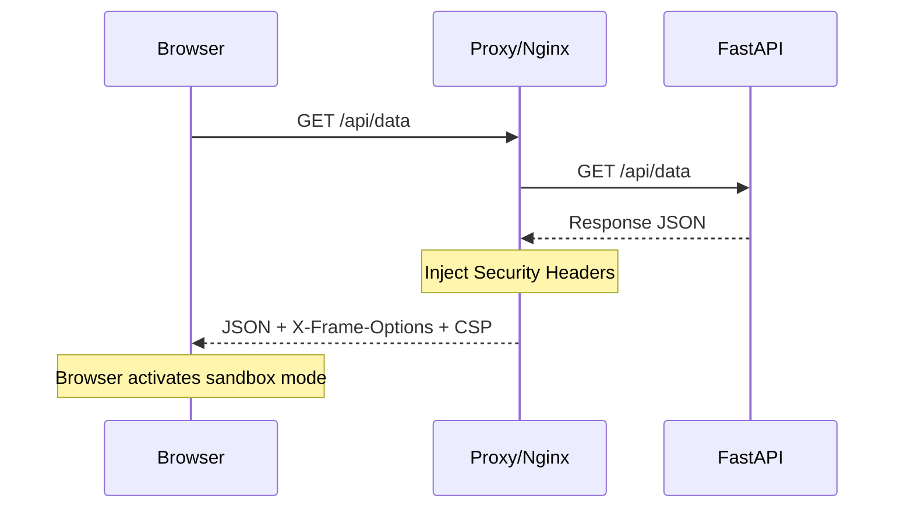

## 7. Complete Practical Example

Let's build a FastAPI application with HTTPS enforcement and basic security headers.

### Complete Security Middleware

```python
from fastapi import FastAPI, Request
from fastapi.responses import RedirectResponse
from starlette.middleware.base import BaseHTTPMiddleware
from typing import Callable
import os

app = FastAPI(
    title="Secure FastAPI Application",
    description="FastAPI with HTTPS and security headers",
    version="1.0.0"
)

class SecurityHeadersMiddleware(BaseHTTPMiddleware):
    """
    Comprehensive security headers middleware.

    Adds multiple security headers to all responses to protect
    against common web vulnerabilities.
    """

    async def dispatch(
        self,
        request: Request,
        call_next: Callable
    ):
        response = await call_next(request)

        # Content Security Policy
        # Restricts resource loading to prevent XSS
        response.headers["Content-Security-Policy"] = (
            "default-src 'self'; "
            "script-src 'self'; "
            "style-src 'self' 'unsafe-inline'; "
            "img-src 'self' data: https:; "
            "font-src 'self'; "
            "connect-src 'self'; "
            "frame-ancestors 'none'; "
            "base-uri 'self'; "
            "form-action 'self'"
        )

        # Prevent clickjacking
        response.headers["X-Frame-Options"] = "DENY"

        # Prevent MIME type sniffing
        response.headers["X-Content-Type-Options"] = "nosniff"

        # Remove server header (don't reveal technology)
        response.headers["Server"] = "Secure Server"

        return response

class HTTPSRedirectMiddleware(BaseHTTPMiddleware):
    """
    Redirect HTTP requests to HTTPS.

    Checks X-Forwarded-Proto header to detect HTTP connections
    behind a reverse proxy and redirects to HTTPS.
    """

    async def dispatch(
        self,
        request: Request,
        call_next: Callable
    ):
        # Only enforce HTTPS in production
        if os.getenv("ENVIRONMENT") == "production":
            # Check if request came via HTTP
            if request.headers.get("x-forwarded-proto") == "http":
                # Build HTTPS URL
                https_url = str(request.url).replace("http://", "https://", 1)
                return RedirectResponse(https_url, status_code=301)

        response = await call_next(request)
        return response

# Add middleware
app.add_middleware(SecurityHeadersMiddleware)
app.add_middleware(HTTPSRedirectMiddleware)

@app.get("/")
async def root():
    """
    Root endpoint.

    Returns basic API information.
    """
    return {
        "message": "Secure API",
        "version": "1.0.0",
        "security": {
            "https": "enforced",
            "headers": "enabled"
        }
    }

@app.get("/health")
async def health_check():
    """
    Health check endpoint.

    Returns API health status.
    """
    return {"status": "healthy"}

@app.get("/headers")
async def show_headers(request: Request):
    """
    Display request headers.

    Useful for debugging security configuration.
    """
    return {
        "headers": dict(request.headers),
        "url": str(request.url),
        "scheme": request.url.scheme
    }

if __name__ == "__main__":
    import uvicorn

    # For development with self-signed certificate
    uvicorn.run(
        "main:app",
        host="0.0.0.0",
        port=8000,
        ssl_keyfile="./key.pem",
        ssl_certfile="./cert.pem",
        reload=True
    )
```

### Running the Application

#### Development (Self-Signed Certificate)

```bash
# Generate self-signed certificate
openssl req -x509 -newkey rsa:4096 -nodes \
  -keyout key.pem -out cert.pem -days 365 \
  -subj "/CN=localhost"

# Run with SSL
uvicorn main:app --host 0.0.0.0 --port 8000 \
  --ssl-keyfile=./key.pem --ssl-certfile=./cert.pem

# Visit: https://localhost:8000
# (Browser will warn about self-signed certificate)
```

#### Production (with Nginx)

```nginx
# /etc/nginx/sites-available/fastapi-app

server {
    listen 80;
    server_name example.com;

    # Redirect HTTP to HTTPS
    return 301 https://$server_name$request_uri;
}

server {
    listen 443 ssl http2;
    server_name example.com;

    # SSL Certificate
    ssl_certificate /etc/letsencrypt/live/example.com/fullchain.pem;
    ssl_certificate_key /etc/letsencrypt/live/example.com/privkey.pem;

    # Modern SSL configuration
    ssl_protocols TLSv1.2 TLSv1.3;
    ssl_prefer_server_ciphers off;
    ssl_ciphers ECDHE-ECDSA-AES128-GCM-SHA256:ECDHE-RSA-AES128-GCM-SHA256;

    # Security headers (in case app doesn't set them)
    add_header Strict-Transport-Security "max-age=31536000; includeSubDomains" always;
    add_header X-Frame-Options "DENY" always;
    add_header X-Content-Type-Options "nosniff" always;

    location / {
        proxy_pass http://127.0.0.1:8000;
        proxy_set_header Host $host;
        proxy_set_header X-Real-IP $remote_addr;
        proxy_set_header X-Forwarded-For $proxy_add_x_forwarded_for;
        proxy_set_header X-Forwarded-Proto $scheme;
    }
}
```

```bash
# Enable site
sudo ln -s /etc/nginx/sites-available/fastapi-app \
            /etc/nginx/sites-enabled/

# Test configuration
sudo nginx -t

# Reload Nginx
sudo systemctl reload nginx

# Run FastAPI (without SSL, Nginx handles it)
uvicorn main:app --host 127.0.0.1 --port 8000
```

---

## 8. Testing Your Security Setup

### Using curl

Test your security headers:

```bash
# Basic request
curl -I https://example.com

# Check specific headers
curl -I https://example.com | grep -i "content-security-policy"
curl -I https://example.com | grep -i "x-frame-options"
curl -I https://example.com | grep -i "x-content-type-options"

# Test HTTP to HTTPS redirect
curl -I http://example.com

# Verbose SSL information
curl -v https://example.com

# Check SSL certificate
curl -vI https://example.com 2>&1 | grep -i "subject\|issuer\|expire"
```

### Browser DevTools

1. Open DevTools (F12)
2. Go to Network tab
3. Visit your site
4. Click on the request
5. Check "Response Headers"

Look for:

```
Content-Security-Policy: ...
X-Frame-Options: DENY
X-Content-Type-Options: nosniff
Strict-Transport-Security: ...
```

### SSL Labs Test

Use [SSL Labs](https://www.ssllabs.com/ssltest/) to test your SSL configuration:

```
https://www.ssllabs.com/ssltest/analyze.html?d=example.com
```

**What it checks:**

- Certificate validity
- Protocol support
- Cipher suite strength
- Vulnerabilities
- Configuration best practices

**Target grade: A or A+**

### Security Headers Test

Use [Security Headers](https://securityheaders.com/):

```
https://securityheaders.com/?q=example.com
```

**What it checks:**

- Content-Security-Policy
- X-Frame-Options
- X-Content-Type-Options
- Strict-Transport-Security
- Referrer-Policy
- Permissions-Policy

**Target grade: A or A+**

### Testing Script

```python
import requests

def test_security_headers(url: str):
    """Test security headers on a URL"""

    response = requests.get(url)
    headers = response.headers

    required_headers = {
        "Content-Security-Policy": "CSP",
        "X-Frame-Options": "Clickjacking Protection",
        "X-Content-Type-Options": "MIME Sniffing Protection",
        "Strict-Transport-Security": "HSTS",
    }

    print(f"Testing: {url}\n")

    for header, description in required_headers.items():
        if header in headers:
            print(f"✓ {description}: {headers[header][:50]}...")
        else:
            print(f"✗ {description}: MISSING")

    print(f"\nStatus Code: {response.status_code}")
    print(f"HTTPS: {'Yes' if url.startswith('https') else 'No'}")

# Test your site
test_security_headers("https://example.com")
```

---

## 9. Common Pitfalls

As a backend engineer, a single misconfiguration can bypass all your security efforts. Below are the most critical mistakes made when implementing HTTPS and Security Headers.

---

### 1. The "Open Door" (Accepting Plain HTTP)

**The Mistake:**
Assuming that because your server supports HTTPS, it is automatically secure. If you leave port 80 (HTTP) open without a redirect, users—or automated scripts—may connect over an unencrypted channel.

**The Risk:**
This allows for **SSL Stripping** attacks. An attacker on the same network (like public Wi-Fi) can intercept the initial HTTP request and prevent the user from ever upgrading to HTTPS. This enables the attacker to read passwords, session tokens, and PII (Personally Identifiable Information) in plaintext.

#### Failure Scenario

The server is passive. It accepts encrypted data on port 443 but still processes unencrypted data on port 80 without intervention.

```python
# Unsafe: This endpoint is reachable via http://api.example.com/login
# An attacker can perform packet sniffing to read the 'credentials' body.
@app.post("/login")
async def login(credentials: Credentials):
    return {"status": "authenticated"}

```

#### Engineering Solution: Active Redirection

In a production environment, your FastAPI app usually sits behind a Reverse Proxy (Nginx). You must check the `X-Forwarded-Proto` header to identify if the user's original connection was insecure and force an upgrade.

```python
from fastapi import Request
from fastapi.responses import RedirectResponse

@app.middleware("http")
async def enforce_https_middleware(request: Request, call_next):
    # Detect the protocol used by the client before it reached the proxy
    # 'x-forwarded-proto' is a standard header injected by Nginx/Load Balancers
    proto = request.headers.get("x-forwarded-proto", "http")

    if proto == "http":
        # Force a 301 Permanent Redirect to the secure HTTPS version of the URL
        secure_url = request.url.replace(scheme="https")
        return RedirectResponse(url=secure_url, status_code=301)

    return await call_next(request)

```

#### Protocol Upgrade Flow

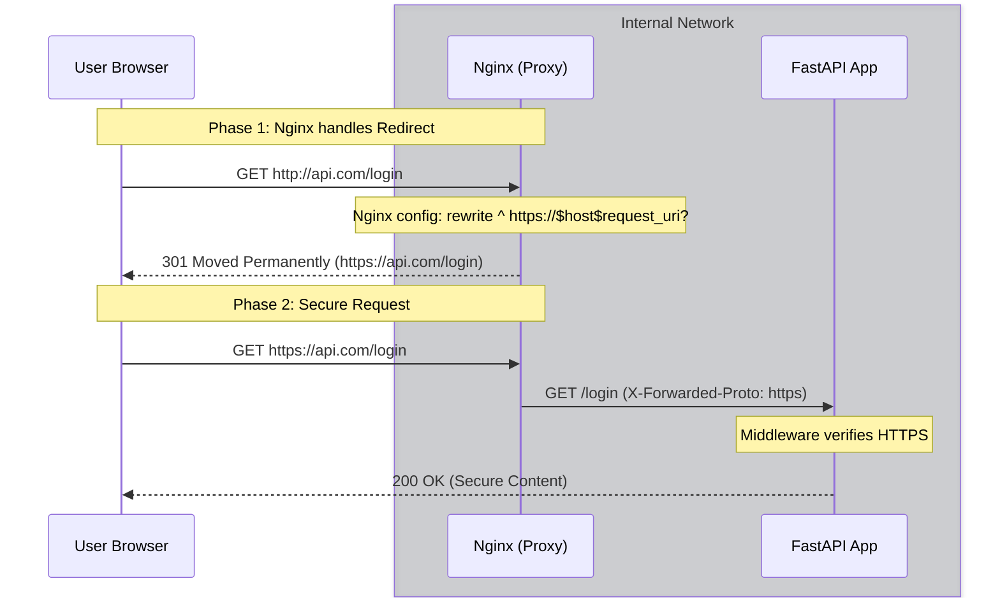

---

### 2. Vulnerable Session Cookies

**The Mistake:**
Leaving session cookies with default settings. By default, cookies are "loose"—they can be accessed by JavaScript and transmitted over unencrypted HTTP connections.

**The Risk:**

1. **Session Hijacking (via Packet Sniffing):** If `secure=True` is missing, a browser will send your session cookie over an unencrypted Wi-Fi network if the user accidentally types `http://`. An attacker can steal this token and log in as the user.
2. **Cross-Site Scripting (XSS) Theft:** If `httponly=True` is missing, any malicious script injected into your page (XSS) can run `document.cookie` to steal the user's session token and send it to an attacker's server.

#### Incorrect Implementation

The cookie is fully exposed to both the network and the browser's JavaScript engine.

```python
# Unsafe: Vulnerable to both network sniffing and XSS theft
@app.post("/login")
async def login(response: Response):
    response.set_cookie(key="session_id", value="secret_token_123")
    return {"message": "Logged in"}

```

#### Correct Implementation (The "Locked Down" Cookie)

As a backend engineer, you must explicitly define the scope and security constraints of the cookie to protect the user's session.

```python
from fastapi import FastAPI, Response

app = FastAPI()

@app.post("/login")
async def login(response: Response):
    response.set_cookie(
        key="session_id",
        value="secret_token_123",

        # 1. Network Security: Only send via HTTPS
        secure=True,

        # 2. Browser Security: Prevent JavaScript access (XSS Protection)
        httponly=True,

        # 3. Cross-Site Security: Prevent CSRF attacks
        # 'strict' ensures the cookie is only sent for requests originating
        # from your own domain.
        samesite="strict",

        # 4. Scope: Define where the cookie is valid
        path="/",

        # 5. Expiration: Limit the lifetime of the session
        max_age=3600  # 1 hour in seconds
    )
    return {"status": "secure_session_created"}

```

---

### Comparison of Cookie Attributes

| Attribute               | Security Benefit                                  | Failure Consequence                              |
| ----------------------- | ------------------------------------------------- | ------------------------------------------------ |
| **`secure=True`**       | Forces the cookie to be encrypted during transit. | Token sent in plaintext over HTTP.               |
| **`httponly=True`**     | Hides the cookie from `document.cookie`.          | Malicious scripts can steal the session.         |
| **`samesite="strict"`** | Restricts the cookie to first-party contexts.     | Vulnerable to Cross-Site Request Forgery (CSRF). |

---

### Visualizing the Protection

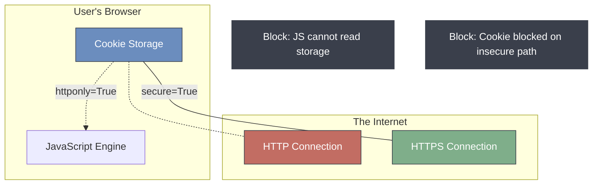

---

### 3. The "Placebo" CSP

**The Mistake:**
Creating a Content-Security-Policy (CSP) that is too permissive. Using wildcards (`*`) or permissive keywords like `'unsafe-inline'` and `'unsafe-eval'` creates a "Placebo Effect"—you have the header present, but it provides no actual security.

**The Risk:**
An overly loose CSP fails to prevent **Cross-Site Scripting (XSS)**. If an attacker can inject a script, a loose policy will allow the browser to execute it, load external malicious payloads, or exfiltrate data to an attacker-controlled server.

#### Incorrect Implementation

The policy is "open," effectively telling the browser to trust everything.

```python
# Unsafe: Defeats the purpose of CSP
# - 'unsafe-inline' allows scripts written directly in HTML
# - '*' allows loading scripts from any domain on the internet
csp_policy = "default-src *; script-src * 'unsafe-inline';"

@app.middleware("http")
async def add_weak_csp(request, call_next):
    response = await call_next(request)
    response.headers["Content-Security-Policy"] = csp_policy
    return response

```

#### Correct Implementation (The "Whitelist" Strategy)

As a backend engineer, you should start with a "Deny All" approach and only whitelist the specific sources your application requires. For a standard API or a secure frontend, you should be explicit.

```python
from fastapi import FastAPI, Request

app = FastAPI()

@app.middleware("http")
async def add_strict_csp(request: Request, call_next):
    response = await call_next(request)

    # 1. default-src 'none': Block everything by default
    # 2. script-src 'self': Only allow JS from your own domain
    # 3. connect-src 'self': Only allow API calls to your own domain
    # 4. img-src 'self' https://trusted.com: Allow images from self and one specific CDN
    csp_rules = [
        "default-src 'none'",
        "script-src 'self'",
        "connect-src 'self'",
        "img-src 'self' https://trusted-images.com",
        "style-src 'self'",
        "frame-ancestors 'none'"
    ]

    response.headers["Content-Security-Policy"] = "; ".join(csp_rules)
    return response

```

---

### Dangerous CSP Keywords to Avoid

| Keyword               | Why it is dangerous                                     | Recommended Alternative                                 |
| --------------------- | ------------------------------------------------------- | ------------------------------------------------------- |
| **`*` (Wildcard)**    | Allows resources from any URL.                          | Use specific domains (e.g., `https://cdn.example.com`). |
| **`'unsafe-inline'`** | Allows `<script>` tags inside HTML.                     | Use external `.js` files or a **nonce** (unique token). |
| **`'unsafe-eval'`**   | Allows the use of `eval()` in JavaScript.               | Refactor code to avoid dynamic execution.               |
| **`data:`**           | Allows base64 encoded strings (often used to hide XSS). | Host images/files properly on a server or CDN.          |

---

### Visualization: The CSP Filter

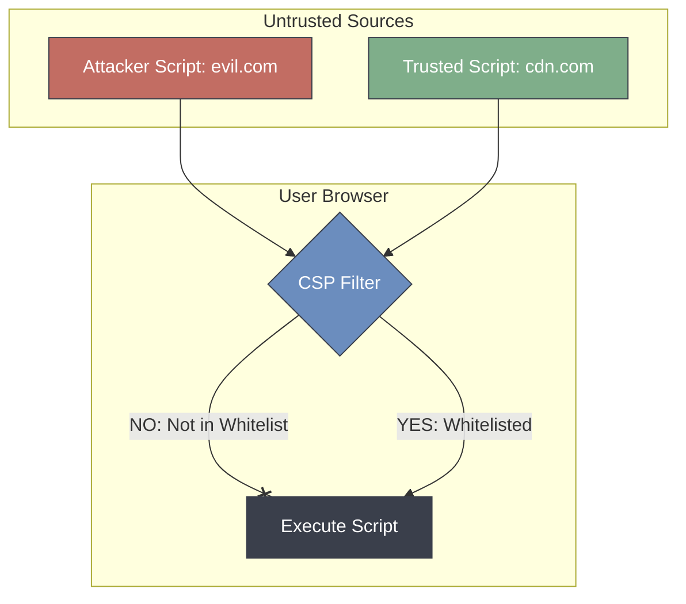

---

## 4. Production "Self-Signing"

### The Mistake

Using a self-signed certificate in a production environment because it bypasses the "hassle" of dealing with a Certificate Authority (CA). While it provides encryption, it lacks **trusted identity**.

### The Reality: Handshake Failure

A certificate serves two roles: encryption and authentication. A self-signed certificate only provides encryption. Since no trusted third party (like Let's Encrypt or DigiCert) has verified that you own the domain, the following happens:

1. **Web Browsers:** Display a full-page "Your connection is not private" warning. Most users will immediately leave the site.
2. **Mobile Apps:** Mobile OS security layers (like iOS App Transport Security) will block the connection entirely, causing the app to crash or show no data.
3. **API Clients:** Libraries like `httpx`, `requests`, or `curl` will throw an `SSLCertVerificationError` and terminate the request unless explicitly told to ignore security (which is a dangerous practice).

#### Self-Signed Certificate Flow

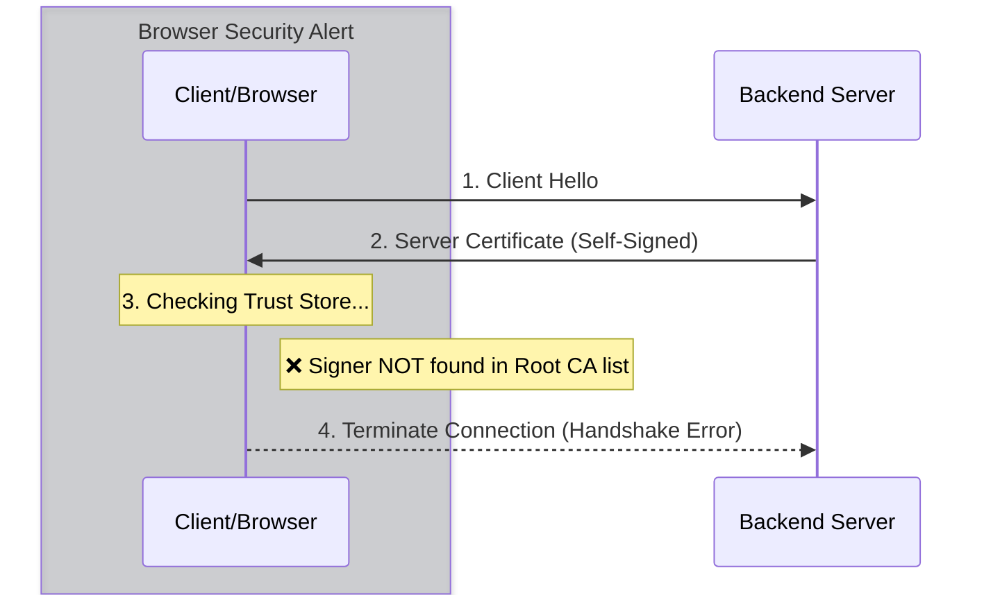

---

### The Engineering Solution: Automated Trust

In modern backend engineering, there is no reason to use self-signed certificates for public-facing apps.

**1. Use Let's Encrypt (Production)**
It is a free, automated, and open Certificate Authority. By using the ACME protocol, your server can prove ownership of a domain and receive a globally trusted certificate in seconds.

**2. Automate with Certbot**
Certbot is the standard tool to manage Let's Encrypt certificates. It handles the request, the challenge (proving you own the domain), and the installation.

```bash
# Obtain a certificate using a temporary standalone server
sudo certbot certonly --standalone -d api.example.com

```

**3. Use Self-Signed ONLY for Local Development**
Self-signed certificates are only acceptable when testing HTTPS locally (e.g., `https://localhost:8000`). Even then, tools like `mkcert` are preferred as they create a local CA that your machine trusts.

---

### Comparison: Self-Signed vs. CA-Signed

| Feature                   | Self-Signed         | CA-Signed (Let's Encrypt) |
| ------------------------- | ------------------- | ------------------------- |
| **Encryption**            | ✅ Yes              | ✅ Yes                    |
| **Browser Trust**         | ❌ No (Red Warning) | ✅ Yes (Padlock icon)     |
| **Identity Verification** | ❌ No               | ✅ Yes                    |
| **Cost**                  | Free                | Free                      |
| **Automation**            | Manual              | **Fully Automated**       |

---

## 5. Manual Renewal Fatigue

### The Mistake

Relying on human memory or manual intervention to renew SSL/TLS certificates. In the modern backend landscape, particularly with providers like **Let's Encrypt**, certificates are designed to be short-lived.

### The Consequence: The "Day 91" Outage

Let's Encrypt certificates are valid for exactly **90 days**. This is a security feature (limiting the impact of a compromised key), but it becomes a massive operational risk if not automated.

- **Service Blackout:** On the 91st day, the certificate becomes invalid.
- **Browser Blockage:** Users see a "Your connection is expired" error.
- **System Failure:** Mobile apps and background workers using `strict` SSL verification will stop communicating with your API, leading to a total system outage.

---

### The Engineering Solution: Automated Renewal

As a backend engineer, you should treat certificate renewal as a "set and forget" background task.

#### 1. Verifying Automated Renewal

If you installed Certbot via `snap` or `apt` on most Linux distributions, it automatically installs a **systemd timer** or a **cron job** to handle renewals. You should verify this immediately upon server setup.

```bash
# Check if the systemd renewal timer is active
systemctl list-timers | grep certbot

```

#### 2. The Dry Run

Before leaving your server in production, always test that the renewal process can successfully talk to the Certificate Authority (CA) and complete the "challenge" without human input.

```bash
# Simulate a renewal without actually changing the certificate
sudo certbot renew --dry-run

```

#### 3. Post-Renewal Hooks

A common pitfall is renewing the certificate on disk but forgetting to tell the web server (Nginx/Traefik) to use the new file. Nginx loads the certificate into memory; if you don't reload Nginx, it continues to serve the old, expired certificate.

You can automate the reload using a **deploy hook**:

```bash
# Renew and automatically reload Nginx only if the renewal was successful
sudo certbot renew --post-hook "systemctl reload nginx"

```

---

### Renewal Lifecycle

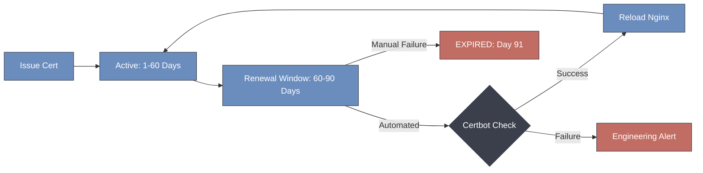

---

### Summary of Best Practices

- **Monitor Expiration:** Use external monitoring tools (like UptimeRobot or Datadog) to alert you if a certificate is within 10 days of expiration.
- **Centralize:** If scaling across multiple servers, terminate SSL at a Load Balancer so you only have one certificate to automate rather than one per server.
- **Permissions:** Ensure the user running the renewal task has permission to write to `/etc/letsencrypt/` and reload the web server service.

## 6. Information Leakage (The "Server" Header)

### The Mistake

Broadcasting the exact technology stack and version numbers in every HTTP response. By default, many web servers and frameworks include headers like `Server` or `X-Powered-By`.

### The Risk: Targeted Reconnaissance

Security is built in layers, and the first layer is often "security through obscurity." While knowing your tech stack isn't a vulnerability by itself, it provides a roadmap for attackers:

- **Version-Specific Exploits:** If an attacker sees `uvicorn/0.27.0`, they can immediately search CVE databases for known vulnerabilities specific to that version.
- **Reduced Attack Surface:** Knowing you use `FastAPI` tells an attacker to focus on Python/Asgi-related exploits rather than PHP or Go-specific attack vectors.

#### Incorrect Implementation

The response headers act as a fingerprint for your infrastructure.

```http
# HTTP Response Headers
HTTP/1.1 200 OK
Content-Type: application/json
Server: uvicorn/0.27.0
X-Powered-By: FastAPI

```

---

### The Engineering Solution: Header Masking

As a backend engineer, you should sanitise your outgoing responses to provide as little information as possible about the underlying infrastructure.

#### 1. Implementation in FastAPI Middleware

You can intercept every response and overwrite the `Server` header with a generic value.

```python
from fastapi import Request

@app.middleware("http")
async def sanitize_headers(request: Request, call_next):
    response = await call_next(request)

    # Overwrite identifying information with a generic string
    response.headers["Server"] = "Secure Server"

    # Remove framework-specific headers if they exist
    if "X-Powered-By" in response.headers:
        del response.headers["X-Powered-By"]

    return response

```

#### 2. Implementation at the Proxy (Nginx)

It is often more efficient to handle this at the Reverse Proxy. Nginx can be configured to hide its own version or overwrite headers from the backend.

```nginx
# Inside the http or server block
server_tokens off; # Removes the Nginx version number

location / {
    proxy_pass http://localhost:8000;
    # Overwrite the Server header from FastAPI/Uvicorn
    proxy_hide_header X-Powered-By;
    add_header Server "Secure Server" always;
}

```

---

### Fingerprinting Comparison

| Header             | Default Value (Leaked)           | Recommended Value              |
| ------------------ | -------------------------------- | ------------------------------ |
| **`Server`**       | `uvicorn/0.x.x` or `nginx/1.x.x` | `Webserver` or `Secure Server` |
| **`X-Powered-By`** | `FastAPI` or `Express`           | (Remove entirely)              |
| **`X-Runtime`**    | `0.05400`                        | (Remove entirely)              |

---

### Visualization: The Information Filter

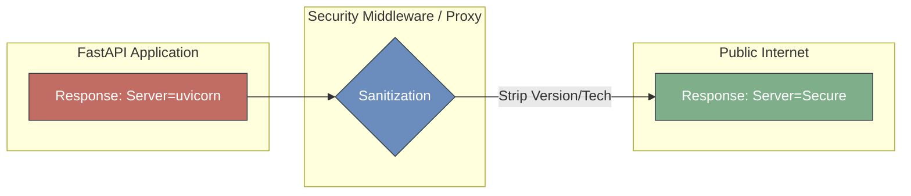

---

## 7. The "Mixed Content" Trap

### The Mistake

Serving the main HTML document over a secure HTTPS connection while attempting to load sub-resources (scripts, styles, or images) over an unencrypted HTTP connection.

### The Risk: Active vs. Passive Mixed Content

When a browser detects mixed content, it treats it as a security breach. There are two primary types of risk:

1. **Active Mixed Content (Scripts, Iframes, CSS):** These are the most dangerous. If a script is loaded over HTTP, an attacker can intercept the request and inject malicious code. Browsers will **block** these automatically, breaking your application functionality.
2. **Passive Mixed Content (Images, Audio, Video):** These are less critical but still leak data. An attacker can see which images a user is viewing. Browsers typically allow these but will remove the "Secure" padlock icon and show a warning, damaging user trust.

#### Incorrect Implementation

The browser sees a secure page requesting an insecure resource, creating a "security leak."

```html
<script src="http://cdn.external.com/library.js"></script>


```

---

### The Engineering Solution: Protocol Consistency

As a backend engineer, you must ensure that all URLs generated by your API or served by your application use the `https://` scheme.

#### 1. Always Use HTTPS for External Resources

Ensure all CDN links and external API calls use the secure protocol.

```html
<script src="https://cdn.external.com/library.js"></script>
```

#### 2. Protocol-Relative URLs (Legacy)

In the past, engineers used `//` to match the current page's protocol. However, modern best practice is to explicitly define `https://`.

```html
<script src="//cdn.external.com/library.js"></script>
```

#### 3. Using CSP to Upgrade Insecure Requests

If you are migrating a legacy site with thousands of HTTP links, you can use a **Content-Security-Policy** directive to tell the browser to automatically "upgrade" every HTTP request to HTTPS before sending it.

```python
# FastAPI Middleware example
@app.middleware("http")
async def upgrade_insecure_requests(request, call_next):
    response = await call_next(request)
    # Tells the browser: "If you see http://, try https:// instead"
    response.headers["Content-Security-Policy"] = "upgrade-insecure-requests"
    return response

```

---

### Mixed Content Impact Table

| Resource Type   | Example                   | Browser Action    | Risk Level        |
| --------------- | ------------------------- | ----------------- | ----------------- |
| **Active**      | `.js`, `.css`, `<iframe>` | **Blocked**       | High (Injection)  |
| **Passive**     | `.png`, `.jpg`, `.mp4`    | **Warning shown** | Medium (Privacy)  |
| **XHR / Fetch** | `API calls`               | **Blocked**       | High (Data Theft) |

---

### Visualization: The Mixed Content Block

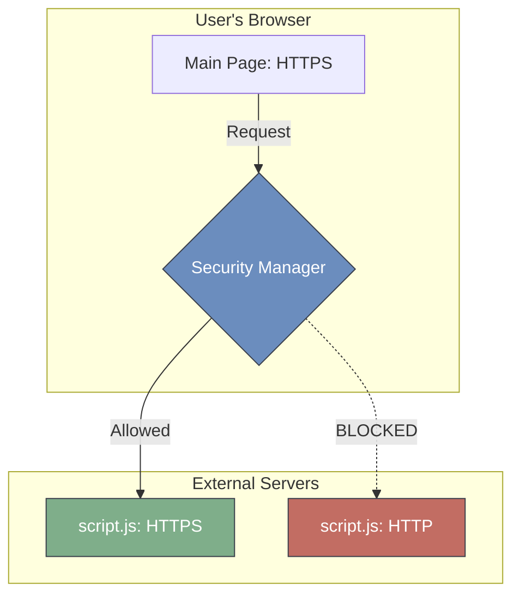

### Summary Table for Fast Review

| Pitfall                | Impact                   | Fix                                             |
| ---------------------- | ------------------------ | ----------------------------------------------- |
| **No HTTP Redirect**   | Man-in-the-Middle (MITM) | Use `HTTPSRedirectMiddleware` or Nginx 301.     |
| **Missing `httponly`** | XSS Token Theft          | Always set `httponly=True` for session cookies. |
| **Expired Certs**      | Complete Service Outage  | Automate renewal via `certbot renew`.           |
| **Missing `nosniff`**  | MIME Sniffing XSS        | Add `X-Content-Type-Options: nosniff`.          |
| **Public Private Key** | Identity Theft           | Never commit `.key` or `privkey.pem` to Git.    |

---


## 10. Key Takeaways

### Security Fundamentals

1. **Always use HTTPS in production**

   - Encrypts data in transit
   - Authenticates server identity
   - Protects data integrity

2. **Use TLS 1.2+ only**

   - Disable TLS 1.0 and 1.1
   - Prefer TLS 1.3 when possible

3. **Certificates must be from trusted CAs**

   - Use Let's Encrypt for free certificates
   - Automate certificate renewal

4. **SSL termination is typically done at proxy/load balancer**
   - Nginx or reverse proxy in single-server setups
   - Load balancer in cloud/multi-server setups

### Security Headers

5. **Content-Security-Policy prevents XSS**

   - Start restrictive, relax as needed
   - Test thoroughly before deploying

6. **X-Frame-Options prevents clickjacking**

   - Use DENY unless you need framing
   - Or use CSP frame-ancestors

7. **X-Content-Type-Options prevents MIME sniffing**

   - Always set to "nosniff"
   - Critical for file uploads

8. **Security is layered**
   - Defense in depth
   - Multiple security measures
   - Assume each layer can fail

### Production Checklist

- [ ] HTTPS enabled with valid certificate
- [ ] HTTP redirects to HTTPS
- [ ] Security headers configured
- [ ] Cookies have secure flags
- [ ] Certificate auto-renewal setup
- [ ] SSL configuration tested (SSL Labs)
- [ ] Security headers tested
- [ ] Monitoring for certificate expiration

---

## 11. Practice Exercises

### Exercise 1: Generate Self-Signed Certificate

Create a self-signed certificate and run FastAPI with HTTPS locally.

```bash
# Generate certificate
openssl req -x509 -newkey rsa:4096 -nodes \
  -keyout key.pem -out cert.pem -days 365 \
  -subj "/CN=localhost"

# Run FastAPI with SSL
uvicorn main:app --ssl-keyfile=key.pem --ssl-certfile=cert.pem
```

**Task**: Visit https://localhost:8000 and examine the certificate in your browser.

### Exercise 2: Security Headers Middleware

Create middleware that adds all basic security headers.

```python
class SecurityHeadersMiddleware(BaseHTTPMiddleware):
    async def dispatch(self, request, call_next):
        response = await call_next(request)

        # Add headers here
        response.headers["X-Frame-Options"] = "DENY"
        # Add: CSP, X-Content-Type-Options

        return response
```

**Task**: Test headers with curl or browser DevTools.

### Exercise 3: HTTPS Redirect

Implement middleware that redirects HTTP to HTTPS.

**Task**: Test with `curl -L http://localhost:8000` (follow redirects).

### Exercise 4: CSP Policy

Create a Content-Security-Policy that:

- Allows scripts only from your domain
- Allows styles from your domain and Google Fonts
- Blocks all framing

**Task**: Test with a simple HTML page that tries to load external scripts.

### Exercise 5: Certificate Expiration Check

Write a script to check if a certificate is expiring soon.

```python
import ssl
import socket
from datetime import datetime

def check_certificate_expiration(hostname, port=443):
    # Get certificate
    cert = ssl.get_server_certificate((hostname, port))

    # Parse certificate
    # Extract expiration date
    # Calculate days until expiration

    pass
```

**Task**: Alert if certificate expires in < 30 days.

---

## What's Next?

**Tomorrow (Day 2)**: We'll dive deeper into:

1. **Advanced Security Headers**

   - Strict-Transport-Security (HSTS)
   - Referrer-Policy
   - Permissions-Policy

2. **CORS Deep Dive**
   - Preflight requests
   - Credentials handling
   - Complex CORS scenarios

Stay tuned for more security best practices!

---

## Additional Resources

### Official Documentation

- [FastAPI Security](https://fastapi.tiangolo.com/tutorial/security/)
- [Mozilla Web Security Guidelines](https://infosec.mozilla.org/guidelines/web_security)
- [OWASP Cheat Sheets](https://cheatsheetseries.owasp.org/)

### Tools

- [SSL Labs Test](https://www.ssllabs.com/ssltest/)
- [Security Headers](https://securityheaders.com/)
- [Let's Encrypt](https://letsencrypt.org/)

### Further Reading

- [HTTPS Explained](https://howhttps.works/)
- [CSP Guide](https://content-security-policy.com/)
- [Certificate Transparency](https://certificate.transparency.dev/)
